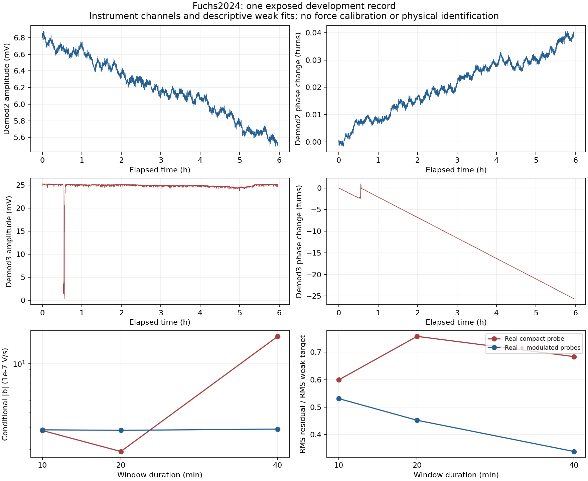

# Complex-probe development results

This is a post-exposure refinement of the single selected Fuchs2024 trace.
The v1 real-probe results and their inadequacies remain unchanged. The other
seven deposited arrays remain unopened. All results are conditional instrument
diagnostics, without physical wiring identification, force calibration, scalar
parameter estimation or an independent empirical test.

The registered extension uses both a real compact probe and a modulated compact
probe in every time window. The modulation is the affine unwrapped phase slope
of the candidate source on the full development record. Thus even the later-time
coefficient check uses a measurement functional designed from the full record;
it is not a prospective holdout. Probes on the same window are correlated.
The shared fitter's historical `train_windows` and `validation_windows` keys
count probe rows here. The extension separately reports physical time windows
and groups both probes together in each chronological split. These are not
twice as many independent observations.

For the receiver2/source3, unit-phasor hypothesis, the results are:

| Window seconds | gamma per second | conditional abs(b), V/s | RMS residual / RMS weak target | Later development ratio |
|---:|---:|---:|---:|---:|
|600|1.8133e-5|2.8832e-7|0.5311|0.5137|
|1200|1.4557e-5|2.8557e-7|0.4524|0.4089|
|2400|1.8842e-5|2.9235e-7|0.3388|0.4264|

These ratios concern different collections of weak functionals from v1; their
reduction is not a likelihood improvement or a physical acceptance criterion.
Numerical digits support reproduction, not experimental precision. Normalized
condition numbers near1 do not bound noise in the regressor or establish the
assumed channel and force maps.

The modulated forcing integral avoids the long-window cancellation present in
the real probe. At2400seconds the aggregate input-moment norm is2.77008 for the
modulated probe versus0.0546793 for the real probe. The conditional forcing
coefficient is now much more stable across window lengths. Substantial residuals
remain, and gamma changes across durations. Measured-voltage input gives similar
residual ratios but a different coefficient with different units. Reversing
the two channels produces negative fitted gamma and strong duration dependence;
that diagnostic does not independently identify the real wiring.

The source's affine phase slope is-0.007889811146rad/s, but its affine residual
is4.10605rad RMS and11.4399rad maximum. The plotted raw record contains a marked
demod3 amplitude dip and phase excursion near the first hour. The plot does not
identify its physical cause. No samples were cut, replaced or phase-corrected.
Normalization to unit amplitude can amplify uncertainty near small amplitude;
the original phase and measured-voltage alternatives are both preserved.

## Control history and limits

The first synthetic complex-probe control run had19passes and one failure:
the largest exact-identity residual was1.022986132e-10 against a fixed1e-10
tolerance at a0.05second quadrature step. Source, output and failure receipt are
preserved. The v2 checker halves the step to0.025seconds without changing the
math helper or tolerance and adds explicit refinement comparisons. All23v2
controls pass; the maximum residual falls to2.557016338e-11, consistent with the
observed factor-four quadrature convergence. No experimental input was changed.

The12extension cases are recorded in FUCHS_COMPLEX_DEVELOPMENT_v1.json, bound to
the pre-run code freeze and the post-v1-exposure plan. Thinning comparisons are
numerical integration diagnostics; they do not bound measurement, filter or
model errors. The first-pass distinct parser/checker independently covers all
selected-file records and one original real-probe regression; that check does
not independently implement these12complex-probe cases.

The useful assumption reduction remains precise: a declared constant-coefficient
observation equation can be tested without selecting or subtracting its
homogeneous initial state. Actual instrument/filter history, one-mode closure,
relative-support motion, absolute gain and source-force registration remain
open. Finite moment agreement cannot establish the complete differential law.
No new milestone PR is warranted by these standard support identities alone.

The figure includes all recorded samples and was visually checked by root.
Its exact source and output identities are in FUCHS_FIGURE_IDENTITY_v1.json.
