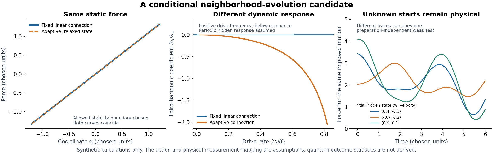

# Neighborhood evolution: personal exploration report

This report covers the user-directed exploration begun at 00:53:06 UTC on
October 16, 2026, with a requested three-hour window ending 03:53:06 UTC.
The full observations-backward campaign remains active until its original
October 16, 22:36:59 UTC deadline. This is a research-block report, not the
campaign's final report. Exact final checkpoint time and source identities
are recorded separately.

The question was whether apparently unrelated endpoints conceal an evolving
neighborhood mechanism: records and their downstream roles form through
intermediate relationships, analogous to the proposed iy → diy → do it yourself
specialization. I treated this as a candidate physical mechanism to construct
and challenge. The linguistic example is motivation, not physical evidence.

## What shook out

There is a useful research direction: **look for different responses to
intermediate interventions among models that agree at the observed endpoints.**
An explicit pair of positive-spring networks has exactly the same unperturbed
endpoint response but different responses when the same physically identified
internal connection is changed. That conditional result is published for
review in [PR 9632](https://github.com/jonathonreilly/qubit-lattice-axiom-framework/pull/9632).
Known matrix inversion and hidden-variable elimination underlie it; the
campaign contribution is the checked conditional discrimination and its limits,
not a claim to have invented those mathematical methods.

The closest construction to the user's idea lets a connection itself evolve
in response to its neighboring state. It produces a causal delayed nonlinear
force, and it can have the same relaxed static force as a fixed connection
while responding differently to changing inputs. That is a concrete way
intermediate history can matter. Its simplest potential fails stability.
A stable family survives, but the potential, coupling and physical
measurement identification remain assumptions.

The most useful reduction of an assumption is a necessary response test that
**does not require the hidden connection to start in a selected state, or even
the same state on different runs**. A differential identity removes the
arbitrary homogeneous hidden motion. Its finite-window integral form avoids
differentiating the measured force. Independent checks confirmed the identity,
coefficient restrictions and error bound. This eliminates preparation from a
test; it does not explain which initial state nature has.

Allowing several adaptive neighbors gives another necessary constraint without
choosing their number or frequencies: a determinant constructed from four
frequency responses has a specified sign for the finite positive-energy class.
A positive, resolved determinant excludes the one-mode reduction. This
frequency test still needs a justified harmonic readout and transient treatment.

These results do not establish that quantum superposition is an artifact of
missing network relationships. The constructed classical mechanisms do not
jointly derive quantum interference, individual detection records, entanglement
statistics and their physical measurement rules. A changing neighborhood can
also be described within conventional physics; a distinctive observation is
required to choose among mechanisms.

The first two panels deliberately select an allowed stability-boundary example:
relaxed static forces coincide, while positive-frequency third-harmonic forces
differ. The periodic hidden response in the second panel is a premise. The
third panel uses a different allowed quartic coefficient and different hidden
starting states; those distinct forces still satisfy the same weak response
identity. The plot contains no measured data.

## A candidate with an explicit failure and a surviving test

For a coordinate difference q and an adaptive connection coordinate w, I tried

    L = m*qdot^2/2 + tau*wdot^2/2 - V + f*q,
    V = k*q^2/2 + C*w^2/2 + g*w*q^2/2 + lambda4*q^4,
    m,tau,k,C > 0.

Completing the square gives

    V = C/2*(w+g*q^2/(2*C))^2 + k*q^2/2
        + (lambda4-g^2/(8*C))*q^4.

The naive lambda4=0, g!=0 model is unbounded below. Stability requires
lambda4>=g^2/(8*C), with no reason supplied to prefer equality. A selected
stabilizing term is not counted as a derived action.

The hidden equation tau*w''+C*w=-g*q^2/2 retains the entire q history in a
causal sine-kernel response. Substituting it into the q equation gives a delayed
cubic force plus a term from the unknown starting state. A pair of reproducible
amplitude preparations can cancel that initial term, but requiring a reset
would just move the assumption. The next calculation removes that requirement
from a different, necessary test.

On an interval where q stays away from zero, set

    z=f/q, a=q''/q, b=q^2, Omega2=C/tau, G=g^2/tau.

Then every trajectory of the chosen action, irrespective of its hidden
preparation, satisfies

    z'' = -Omega2*z + m*a'' + m*Omega2*a + k*Omega2
          + 4*lambda4*b'' + (4*lambda4*Omega2-G/2)*b.

Integrating against a known test function whose value and first derivative
vanish at the window boundaries transfers the second derivatives onto that
test function. This yields a shared six-coefficient relation among finite
integrals of calibrated observations and imposed motion. The coefficients
obey algebraic consistency and positivity conditions; stability is equivalent
to a nonnegative coefficient multiplying integral(b*psi).

Three supplied synthetic trajectories, with unrelated hidden starting states,
recover the shared coefficients with maximum error about 3.4e-12. Two additional
synthetic trajectories satisfy the predicted integral relations to about 6.1e-14;
a 3% perturbation of one coefficient produces a residual about 0.00358.
These numbers demonstrate the numerical calculation in selected units.
They are not measurement precision, an empirical fit or an independent
observation test. Constant trajectories fail the required identification rank. A final exact
counterexample adds a smooth force that all four selected weak test functions
miss, although it violates the underlying action. An additional test function
detects it. Thus even a passing reserved finite test is bounded evidence, not
a derivation of a unique mechanism; see [block19](NETWORK_EVOLUTION_BLOCK19_v1.md).

See [block15](NETWORK_EVOLUTION_BLOCK15_v2.md),
[block16](NETWORK_EVOLUTION_BLOCK16_v1.md) and
[block17](NETWORK_EVOLUTION_BLOCK17_v1.md) for complete domains and derivations.
A further [division-free extension](NETWORK_EVOLUTION_BLOCK18_v1.md) removes
the nonzero-coordinate restriction from a necessary integral test, so signed
trajectories may cross zero. An identically zero trajectory is still blind:
removing a singular formula does not guarantee information.
Their independent derivations, source hashes, reproductions and preserved
findings are in the correspondingly named independent directories.

## What the observations and counterexamples required

Interference averages are an insufficient target. A deterministic threshold
rule can reproduce the average fringe and still predict rigid alternating
records where an iid benchmark has count fluctuations. A different selected
deterministic reservoir can reproduce complete Bernoulli sequence laws, but
that construction imports an initial measure and a physical update rule.
The outcome law has then been encoded, not explained.

Finite closed record reservoirs face an energy/history burden. Under an
explicit fixed-energy-per-record and no-external-work contract, finite stored
energy bounds cumulative count discrepancy. The best causal approximation
has a reflecting-walk construction and a calculable discrepancy from iid
records. Powered detectors and other physical energy sources lie outside
that restricted contract. The result is not a general rejection of detector
physics or evolving networks.

Arbitrary historical memory does not evade a Bell bound under fresh
current settings, local factorization and the stated causal restrictions.
Those premises matter. They do not apply to every conceivable graph, and
renaming a nonlocal or setting-correlated mechanism does not derive its
physical justification.

I reproduced the original Hensen deposited data using a frozen, pre-access
selection plan:245 selected trials,196 wins and CHSH S=2.42249987046137.
The published fixed selection and biased-input tail prescription reproduce
approximately 0.03917. This is a reproduction of already exposed development
evidence, not a new independent test of any proposed network. No selection
threshold was fitted, and the apparatus's timing and setting-independence
premises were not independently remeasured. The original archive/member
identities and the two different input-bias contracts are preserved in
[the reproduction note](HENSEN_RECORD_REPRODUCTION_NOTE_v1.md).
The public source is the
[Hensen data deposit](https://data.4tu.nl/articles/_/12703235/1).

## Derivation ledger

All entries are personally authored calculations with focused independent
checks. Primary control counts are synthetic check families, not experimental
sample sizes. Counts overlap with reproductions and must not be added as
independent evidence.

| Block and current version | Checked result | Essential remaining condition | Primary families |
| --- | --- | --- | ---: |
| 01v2 | Adaptive past cannot supply a fresh missing current input in the stated parity task | Freshness conditional on full history and eligibility | 19 |
| 02v1 | All-angle conservative radial flux selects a quadratic law; simple threshold records alternate | Split geometry, response domain and detector update rule | 18 |
| 03v1 | Pair-relative transport is fixed in a strong symmetry class; a third neighbor restores freedom | Supplied orientation space, reciprocity, continuity and allowed dependencies | 23 |
| 04v1 | A selected reservoir realizes iid laws; finite seeds and singular states expose limits | Initial measure, deterministic map and physical implementation | 18 |
| 05v2 | Context paths yield phase/coherence and correlation-dependent refinement | Chosen context dynamics and correlation scale | 11 |
| 06v1 | Conditional hidden-state renewal characterizes a conjugated family, not a unique state | Chosen measure, target probabilities and monotonicity | 8 |
| 07v1 | Optimal causal finite-energy approximation to ideal iid records | Closed reservoir, fixed event energy and no outside work | 5 |
| 08v2 | Fresh-setting local-memory Bell bound and explicit symmetry insufficiency | Physical causality, setting independence and measurement identification | 8 |
| 09v1 | Hidden-response ambiguity and a common intervention relation | Supplied action, physical control and readout vectors | 7 |
| 10v1 | Earliest nonzero intervention response measures access through a given network | Known coordinate identification, time and source normalization | 5 |
| 11v1 | Common calibration factors cancel from a necessary four-setting relation | Shared calibration and controlled preparation/forcing | 9 |
| 12v2 runner | Two paths share the full reference transport but differ under a chosen context term | Context coupling, closure, phase unwrapping and physical path control | 5 |
| 13v1 | A joint action/gain scaling leaves observed transfer unchanged | Unknown absolute gain; calibrated energy/work can break this family | 6 |
| 14v1 | Well-conditioned paths and deterministic phase-error bounds | Closed anchor, actual geometry, context drift and error bounds | 5 |
| 15v2 | Adaptive connection produces cubic memory; stability restricts a family | Chosen action, parameters and physical force/coordinate bridge | 13 |
| 16v1 | Weak response test cancels arbitrary hidden initial conditions | Common action, calibrated nonzero trajectory and frozen candidate errors | 12 |
| 17v1 | Multi-mode response determinant and moment constraints | Finite passive class, pole-free range and justified harmonic readout | 13 |
| 18v1 | Division-free weak response allows coordinate zero crossings | Actuation derivatives, sufficient excitation and physical calibration | 10 |
| 19v2 runner | A smooth force can evade four selected weak tests and fail the next | Finite test span; no universal impossibility conclusion | 7 |

The canonical intervention runner in PR 9632 consolidates blocks09/10 into
14 control families and13 detected scratch mutations. Its source-bound focused
review is complete. Shared integrated landing gates remain pending; this
report applies no formal audit verdict.

## Assumptions retired from tests, and assumptions still alive

| Assumption | Result of this exploration |
| --- | --- |
| A selected hidden initial state is required for every candidate test | Removed for the block16 necessary weak response identity; still needed to predict individual trajectories |
| Common gain, offset and affine control calibration must always be known | Removed from specified projective/cross-ratio tests; arbitrary setting-dependent calibration remains |
| One hidden oscillator must be chosen before testing a passive adaptive response | Removed for the block17 determinant sign; the passive quadratic hidden class remains assumed |
| Coordinate must stay away from zero to test the adaptive law | Removed for the block18 necessary polynomial weak test; identically zero paths are uninformative |
| Endpoint response determines a unique network | Explicitly false within the checked finite example; interventions can discriminate |
| Stability selects a unique stabilizing potential | False: it gives an inequality, not a selector |
| Unknown past alone accounts for fresh-setting quantum correlations | Not established; the stated local-memory class remains bounded |
| The record law, initial ensemble and Born probabilities have been derived | No; explicit constructions reveal where these are inserted |
| The scalar action, absolute scale and measured-gravity/environment bridge have been derived | No; these remain open |

## Preserved failures and corrections

The original versions are retained. Block01 initially needed an additional
freshness condition on exception eligibility; block05 needed a correct
endpoint record branch; block08 initially omitted the allowed input-bias
domain. Block12's first runner mislabeled signed coherence as visibility;
the corrected runner labels the signed quantity as coherence; visibility would
be its magnitude. Block15's first note
omitted omega>0 when identifying separate harmonics; zero frequency merges
those lines. Its corrected note and runner explicitly separate the static
force from a rational frequency continuation.

Other source-bound review and symbolic execution failures remain in their
original receipts. A passing computation did not erase a source-domain
counterexample. Block19's first runner completed its symbolic checks but failed while
serializing a symbolic integer to JSON; v2 converts that metadata to a native
integer and preserves the failed execution. No scientific conclusion was
drawn from retrieval or tooling errors.

## The next research directions

1. **Prioritize the preparation-independent response test.** Identify an
   actual controlled system with measured force and coordinate histories,
   independent time/actuator calibration and enough variation to identify a
   common model. Freeze the candidate and error budget on development data,
   then test additional histories and test-function shapes without adjusting
   the action per history. A physically justified bandwidth/error contract
   is needed to limit the untested force directions exposed by block19.
   This is the strongest immediate route to eliminate another assumed
   preparation rather than supply it.
2. **Challenge the hidden-sector class.** Test multi-mode constraints before
   choosing a preferred mode count or spectral shape. Explain damping,
   transients and the actual physical connection coordinate. A successful
   classical apparatus test would validate an effective mechanism there,
   not a fundamental quantum theory.
3. **Carry the same common-action discipline back to the scalar theory.**
   Compare environmental responses generated by one physically identified
   action. An independently fitted action or potential for each environment
   would not answer the user's question. Absolute energy/force calibration
   is still required to address the scale ambiguity.
4. **Require joint quantum tests before claiming an explanation of
   superposition.** The same fixed mechanism would need interference under
   controlled phase changes, composition of transformations, record
   correlations and the relevant Bell experiments. Neither a fractal label
   nor a fit to a mean fringe supplies that result.

Nonlinear coupled-mode response is established prior art, including
[third-harmonic dynamics in Kerr cavities](https://arxiv.org/abs/0808.3122)
and [energy transfer between mechanical modes](https://arxiv.org/abs/1612.00490).
Only those abstracts were used as scope checks; neither paper validates
the action constructed here. Read scope, source identities and data status
are recorded in NETWORK_LITERATURE_IDENTITIES_v2.json.

The original publication milestone for the scalar inverse,
[PR 9628](https://github.com/jonathonreilly/qubit-lattice-axiom-framework/pull/9628),
remains separate. The primary checkout and other authors' work are preserved.
Older campaigns remain stopped. The current campaign continues with the
physical measurement bridge and action selection explicitly unresolved.
