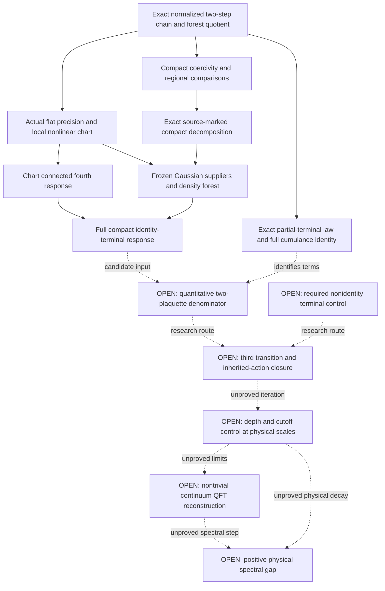

# SU(2) mass-gap lane: proof tree and open dependencies

Working map for [PR #10149](https://github.com/jonathonreilly/qubit-lattice-axiom-framework/pull/10149),
2026-11-09. Continue on this PR and branch; no dependency stack is required.
The map covers the present research route. It does not claim that the listed
open nodes form a proved reduction of the mass-gap problem or an exhaustive
list of every lemma a continuum construction will need.

The present result is finite two-step posterior decay with terminal field
fixed to identity. Its complete argument has fresh-context mathematical
checks, not a formal audit or retained status. There is no proved physical
mass gap and no evidence-based completion percentage or delivery date.

## Target and decision order

For the SU(2) starting case, the eventual target is a nontrivial continuum
Yang-Mills theory on R^4 satisfying the required QFT axioms, with a positive
finite mass and a gap above the vacuum in the physical energy spectrum. The official problem
asks for every compact simple gauge group; this lane currently treats SU(2).
See [Jaffe and Witten's problem statement](https://www.claymath.org/wp-content/uploads/2022/06/yangmills.pdf).
An auxiliary conditioned Hessian or decay rate in block units is not that
spectral statement. No TOE identification follows from the present work.

Solid arrows summarize the current finite-model argument. Dotted arrows
are proposed research dependencies with open hypotheses, not established
implications. The exact-Q node has its separate check status below. A direct
estimate of its marginal law could avoid bounding every conditional term
separately; the diagram does not force one analytic route.

## Complete current finite-model packet

All twenty earlier proof parts are listed here. Their exact SHA-256 identities
and the primary note are bound by the manifest and the frozen reports linked
from [HANDOFF](HANDOFF.md). Historical author headers describe their original
draft state; subsequent gate reports carry the actual checking record.

| Part | What it supplies and where it is used |
|---|---|
| [Compact forest exchange](parts/compact-forest-exchange.md) | Exact Haar quotient, source-dependent orbit law, aligned exchange and true reader sets. Starting law for all branches. |
| [Flat two-step bound](parts/flat-two-step-bound.md) | Actual two-layer precision with both normalized kernels, at fully fixed terminal I. Input to chart and Gaussian estimates. |
| [Nonlinear chart response](parts/nonlinear-chart-response.md) | Local derivatives, chart coercivity and covariance machinery. Input to connected chart and Gaussian producers. |
| [Compact energy coercivity](parts/compact-energy-coercivity.md) | Compact energy control for the pinned two-step model. Input to compact/regional estimates. |
| [Rough density bound](parts/rough-density-bound.md) | Absolute compact-versus-chart density accounting; includes normalization powers. |
| [Local conditional tail](parts/local-conditional-tail.md) | Local conditional tail bounds under its stated exterior hypothesis; not general influence contraction. |
| [Local relative coercivity](parts/local-relative-coercivity.md) | Relative-energy supplier for conditional component estimates. |
| [Rough component bound](parts/rough-component-bound.md) | Component geometry and tails using that relative supplier; not itself a connected logarithm. |
| [Full compact fourth scaling](parts/full-compact-fourth-scaling.md) | Compact local moment and fourth-response scaling; separate from spatial connected decay. |
| [Chart fourth connected bound](parts/chart-fourth-connected-bound.md) | Complete connected cut cancellations and the chart C/u tree bound. |
| [Original-source response](parts/original-source-four-response.md) | Exact orbit covariance correction and its source-class distinctions. |
| [Arbitrary-boundary interior moments](parts/arbitrary-boundary-interior-moments.md) | Interior moment/radial estimates with the specified buffered boundary setup. This does not mean arbitrary terminal backgrounds are solved. |
| [Buffered conditional ratio](parts/buffered-core-conditional-ratio.md) | Regional log ratios with complete source jets and buffers. |
| [Global chart-sector ratio](parts/global-chart-sector-ratio.md) | Exact sector comparisons; an input, not a replacement for a connected expansion. |
| [Two-step compact decomposition](parts/two-step-compact-polymer-decomposition.md) | Exact compact insertion gas for the actual two-step density. |
| [Source-marked decomposition](parts/source-marked-compact-decomposition.md) | Complete source factors, regional denominators and source readers. |
| [Frozen Gaussian producers](parts/frozen-gaussian-producers.md) | Actual fixed-reference covariance, path norms and local Taylor remainders. |
| [Scalar-leg forest count](parts/scalar-leg-forest-count.md) | Combinatorial bound consumed by the density forest. |
| [Zero-shift density forest](parts/zero-shift-marked-density-forest.md) | Connected correction with normalized Gaussian density jets, full-cell activation and all reader costs. |
| [Full connected response](parts/full-connected-four-response.md) | Exact supplier match, compact/chart composition, original-source correction and weighted boundary-pair sum. |

The last composition is checked in the
[composition gate](gates/full-connected-four-response-check.md); the
[primary note](../../../../docs/SU2_CONNECTED_FOUR_RESPONSE_BOUNDED_THEOREM_NOTE_2026-11-09.md)
has its own [text/source gate](gates/primary-note-check.md).
These are same-provider fresh-context research checks. Formal independent
audit remains separate, and all frozen proof bytes remain unchanged here.

The composed claim is for fixed L and kappa, sufficiently large u, finite
volume uniformly, exactly two hidden layers, V=I and distinct terminal links.
Fixed local C^2 quotient singlets have a C/u four-region tree bound.
Original sources retain their conditional orbit covariance, with the stated
O(1) allowance when orbit readers overlap. This is not arbitrary-boundary,
all-depth, continuum, or physical spectral control.

## Work in this PR after the first publication

| Node | Exact deliverable | Current scope |
|---|---|---|
| Q-exact | [Partial-terminal normalization](parts/partial-terminal-normalization.md) | Exact deletion of integrated last-layer kernels, the two distinct-link derivative cases, and all 15 total-cumulance partitions. Fresh-context proof check completed; see the separate report below. |
| Q-geometry | [Released terminal gauge directions](parts/released-terminal-gauge-directions.md) | Explicit residual component-gauge symmetry and precision eigenvectors on the unchanged forest slice. Fresh-context proof check completed; see the separate report below. |
| Q-bound | Not yet proved | Quantitative connected four-response for the actual marginal with the seven-edge union of two adjacent plaquettes integrated and exterior terminal links held. |

[The separate continuation check](gates/partial-terminal-check.md) reconstructs
both new arguments. It does not promote them to formal retained status.

If both varied links lie in the exterior, the log-conditional response
subtracts a fourth cumulant under a different hidden marginal. The exact
conditioning formula contains the expected conditional fourth cumulant,
four third-cumulant/mean covariances, three covariance/covariance terms,
six third cumulants of one conditional covariance and two means, and the
fourth cumulant of the means. The current pi_I theorem does not bound all
these terms or the full released-terminal integration domain.

The geometry diagnostic also prevents indiscriminate reuse of the fully
pinned precision bound: at zero sources and V_O=I, when the retained terminal
graph has r components, the current slice has 3(r-1) explicit gauge directions
of precision 2/(3u).
The eight-edge isolated-vertex example is NOT the seven-edge two-plaquette
problem. It directs attention to the correct quotient and geometry, without
claiming physical masslessness or ruling out this route.

## Next theorem to attack and its acceptance test

Fix the actual seven-edge two-plaquette set J, exterior V_O=I, the present
two-step Wilson/kernel parameters and source class. First establish a
volume-uniform compact coercivity estimate for its exact marginal on a
declared gauge slice, or exhibit the precise failure of that proposed
estimate. The density has only the terminal kernels in O. Every first-layer
kernel, retained terminal kernel and radial normalizer must stay explicit.

A candidate construction is to replace each missing terminal constraint by
a bounded retained-edge detour and controlled curvature terms. It requires
a proof for the actual paired-root-leg means, including small mean norms,
periodic geometry and all source readers. This is a proposal, not an invoked
lemma. Graph connectivity alone and a finite-rank perturbation slogan do
not provide the needed constant. If an adapted quotient is used, its orbit
covariance and locality must be derived before invoking any chart supplier.

If this coercivity supplier closes, recheck the chart/compact decomposition
and obtain a summable bound for the marginal's actual fourth cumulant with
its source class stated. A local success still leaves the class of larger
conditionals and terminal backgrounds needed for iteration to be specified
and controlled. The first third-transition test must use the exact inherited
law, not replace it with a fresh Wilson density.

Reachability is reassessed on these estimates: do their constants survive
the iteration and physical-scale limit required by the target? Until that
question and continuum reconstruction are answered, the repo supplies a
concrete research attack rather than evidence that the mass gap is near.
