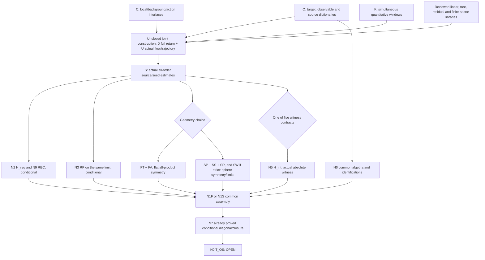

# Critical-path mapping audit of the YM4D program

The branch contains a connected conditional proof program and useful reviewed mechanisms, but **no complete chain to T_OS**. Every presently specified flat/sphere witness chain retains at-risk interfaces. This is not evidence that Yang–Mills is impossible or that the missing interfaces are mutually independent. The highest-value next work is to test the absolute witness and full normalized return contracts before expanding their supporting libraries.

## Snapshot, meaning of status, and coverage

Audit type: **ARGUED dependency/scope assessment**, with existing PROVEN/conditional results attributed to their reviews; no new proof or numerical evidence. HEAD is `814364fcc7dbcf0ff4146f6766e98890124ac905` (`claude/q-L1`). Cached `origin/main` is `01589af3faf806b736c42dc2f3bd625e9edead9f`; cached execution ref is `56c5c0ab64f532c5784e895b2f9aa6894fa334e0`. Fetch failed because shared `FETCH_HEAD` is not writable, so remote freshness is not certified. Source bytes are frozen in [audit_source_manifest.json](checks/audit_source_manifest.json); quotation passages and the graph are recorded in [audit_graph.json](checks/audit_graph.json). The final source/scope check and independent mapping review are separate artifacts.

**LANDED** here means a reviewed/admitted *branch export at the stated finite/model/correction scope*, not mainline landing or formal retained status. **CONDITIONAL** means a reviewed implication with the table's named hypotheses, not those hypotheses proved for YM. **OPEN** means the needed actual producer/compatibility is unproved. **AT-RISK** marks an OPEN interface with a specific suspected obstruction or unsupported shortcut identified in the quoted evidence. Risk labels and rankings are this audit's ARGUED assessment; the adjacent quotation is the source evidence, not a fabricated source verdict using that word. A row containing several finite facts is classified by its stated export/consumer contract, never by its strongest isolated calculation.

Coverage is the 26-node assembly, all 44 S26 registry entries, the eight later assembly-support reviews, the eight named queue units, and 27 reviewed coordinator units plus the pending selected-core/complement assignment. This is a map of claimed exports and their source reviews, **not** a new producer-by-producer proof audit or a claim that every file in the 3,313-file snapshot is a new theorem. Historical check scripts are not promoted into additional scientific results. References retain the exact snapshot's line numbers. Longer quoted passages are shortened only after the displayed words; complete passages are in the evidence JSON.

## Updated implication DAG

The following picture groups the coupled flow/return induction into one **unclosed construction block**. It does not pretend that assuming flow to prove return and return to prove flow is a solved DAG. A valid common induction/fixed-point construction is an explicit U obligation. All arrows are conditional interfaces; boxes labelled as actual inputs are not available objects.

### Original 26 nodes, updated rather than copied from old status paragraphs

| Node / export | One mapping status and exact scope | Source quotation |
|---|---|---|
| **N0 — T_OS** | **OPEN**. Actual R4 SU(N) OS construction and absolute non-freeness on one algebra; neither route supplies all inputs. | “N0. T_OS (target). PROOF §0 "T_OS (the owner's target)": "There is a state on an E(4)-covariant algebra of gauge-invariant observables on R^4. It arises as such a limit, satisfies OS0-OS3 …” ([ASSEMBLY55.md:128–135](ASSEMBLY55.md)) |
| **N1F — Flat assembly** | **CONDITIONAL**. One algebra, common sequence, actual regularity/positivity, full symmetry and continuous strict witness; the original closure implication survives. | “5. CONDITIONAL — The original PANEL_P1 closure argument. On one fixed algebra and one common sequence, convergence of every required finite moment passes normalization, each ordinary positivity form and each …” ([CODEX_REVIEW_ASSEMBLY.md:210](CODEX_REVIEW_ASSEMBLY.md)) |
| **N1S — Sphere assembly** | **CONDITIONAL**. Fixed-R continuum states, common local algebra, SO(5)/pole RP, radius-uniform regularity and witness, then R→∞; regulator admissibility is separate. | “N1S. Sphere assembly lemma (alternative top for the sphere route). Producer: CODEX_REVIEW_P4 §4.1 "Geometry and conditional transfer" (CONFIRMED "with the uniformity and observable hypotheses below") and §4.2 (OS0 local-to-global, CONFIRMED …” ([ASSEMBLY55.md:147–157](ASSEMBLY55.md)) |
| **N2 — H_reg** | **CONDITIONAL**. Actual N1 source contract plus N2 flow positivity imply separated regularity; SP→TP→EXT is available. Actual source estimates and reconstruction seed are still required; ordinary moments are not thereby supplied. | “1. PROVEN conditional theorem: on the stated L-adic tori, with fixed top offset and all N1 clauses R0-R5 plus N2 (Flow-pos), the source radius is n-independent, R_z=r_0 lambda^alpha. The frozen/top …” ([CODEX_REVIEW_SRC2.md:263–270](CODEX_REVIEW_SRC2.md)) |
| **N3 — H_RP** | **CONDITIONAL**. Finite bare-marginal/lattice RP and corrected geometric half-arcs are reviewed. Continuum passage needs the actual convergent hierarchy on the stated test domain. | “Applicable lens outcomes: the finite domain and paired-half proof are CLOSED at the stated supplied-regulator scope; continuum RP transfer is CONDITIONAL on the displayed convergence/domain hypotheses; inputs and normalization conventions …” ([REVIEW_HRP_HALF_ARC_ASTRA.md:74](REVIEW_HRP_HALF_ARC_ASTRA.md)) |
| **N4 — H_Euc** | **OPEN**. All products on the same algebra. Flat needs N11/N12. Sphere uses SS: N13/Ward OR N14/full comparison, with shared sphere transfer and radius inputs. Pair invariance alone is insufficient. | “15. Prove full-algebra Euclidean invariance by the selected route. Flat: all-n CD/SRC/torque bounds and TQ, with any RA-1 replacement checked in its actual formula. Sphere: position-dependent flow, bulk/local transfer, seam …” ([CODEX_REVIEW_ASSEMBLY.md:233](CODEX_REVIEW_ASSEMBLY.md)) |
| **N5 — H_int** | **AT-RISK**. An absolute witness on the reconstructed algebra and actual YM upper/lower/moment estimates are missing. Five alternatives are separated below. | “Single most dangerous unverified item: an absolute non-freeness witness on the same reconstructed OS algebra whose regularity and positivity are proved. The associated Yang–Mills estimates remain open, but identifying their …” ([CODEX_REVIEW_ASSEMBLY.md:237](CODEX_REVIEW_ASSEMBLY.md)) |
| **N6 — ALG and target contract** | **OPEN**. REC now supplies a restricted flat-test construction, but the chosen witness, physical/free identification, multiplication and support maps must match it; no automatic ordinary-product extension. | “I did not establish sharp constants, a general abstract O(4) representation theorem, spinor fields, sharp time-zero fields, vacuum uniqueness, a Euclidean contact extension, or the full Yang–Mills identification. None is …” ([REVIEW2_REC.md:327–330](REVIEW2_REC.md)) |
| **N7 — SEQ / DIAG** | **CONDITIONAL**. Common countable family, per-radius and outer convergence, compatible identifications. DIAG itself needs no new uniform-in-R cutoff-rate theorem. | “1. PROVEN — Diagonal selection (R2). A common countable family, per-radius subsequential convergence, and an outer convergent radius sequence yield one lattice diagonal, with the explicit error <2^{1−j}. This adds …” ([CODEX_REVIEW_ASSEMBLY.md:206](CODEX_REVIEW_ASSEMBLY.md)) |
| **N8 — TRAJ** | **OPEN**. Common normalized bare trajectory, actual finite-u/finite-volume effective flow, continuity and tuning. New volume-first one-loop coefficients do not complete this. | “11. Close the coupled flow/large-field construction. Supply the selected large-field mechanism, normalized reconstruction, (SF-g), (RLF-δ), FI-1's uniform/continuity inputs, actual finite-volume bounds (SF-∞), continuity (SF-cont), and F-tune. State the fixed-point argument …” ([CODEX_REVIEW_ASSEMBLY.md:229–230](CODEX_REVIEW_ASSEMBLY.md)) |
| **N9 — REC** | **CONDITIONAL**. REC_CONT E0′–E3 seed plus reality/normalization and exhaustion feed REC_LIB for finite Cartesian tensors of flat tests; actual YM seed, sharp-time/general tensor extensions remain inputs. | “No material defect found in the current abstract reconstruction implication. REC_CONT supplies the analytic input consumed by REC_LIB for the stated finite Cartesian tensor family, on the stated flat test …” ([REVIEW2_REC.md:3–7](REVIEW2_REC.md)) |
| **N10 — SRC** | **AT-RISK**. Actual all-coarse, all-order, normalized quantum source hierarchy, including failures, holes and higher-level induction. Selected-sector mechanisms exist but do not supply it. | “Not banked: N1's derivation from STEP55 CX/(B2)/I6^C/LF-src, strict source re-localisation with uniform rate, the complete normalised all-V complex representation, plane-dependent Flow-pos, an unconditional separation estimate, the matching-premises V10 refutation, the …” ([CODEX_REVIEW_SRC2.md:270–272](CODEX_REVIEW_SRC2.md)) |
| **N11 — Flat CD / SRC-I5** | **OPEN**. Real/complex tilted envelopes, coarse-source control and appropriate all-order decay for actual Wilson law; exact Markov identities are not decay estimates. | “1. CONFIRMED: the full normalized soft chain is Markov in the level index; B1, B2, the effective-action ratio, first-order linear source evolution, and triangular higher-order recursion are exact. The same …” ([CODEX_REVIEW_SRCCD.md:401–407](CODEX_REVIEW_SRCCD.md)) |
| **N12 — TQ** | **AT-RISK**. Flat far-shell torque remains unverified; available sufficient decay criteria and pair reductions are not an actual Wilson estimate or an impossibility theorem. | “TQ for four-dimensional Wilson Yang–Mills remains NOT-VERIFIED. No proof of its failure, no complete RP no-go theorem, and no completed sphere construction may be banked from this packet.” ([CODEX_REVIEW_TQ.md:798–800](CODEX_REVIEW_TQ.md)) |
| **N13 — Sphere UV package** | **AT-RISK**. Actual bulk/profile/local transfer, all-coarse seam transparency, W1/W3 for all products and radius-uniform limits. The all-coarse condition is load-bearing. | “The first non-UV item. None on this route to an OS0-OS3 state, provided each input holds in conditional form. Two places where that proviso is most likely to fail, in …” ([SPHERE55.md:657–663](SPHERE55.md)) |
| **N14 — Rotated universality** | **CONDITIONAL**. Alternative sphere symmetry supplier: full two-theory conditional comparison, curved/profile/seam inputs, common algebra and radius bounds. Fixed-torus UNIV-T is support, not an R4/TQ bypass without the exterior-law/limit bridge. | “The remaining conditional steps are valid: the common-scale norm must dominate the logarithmic density difference per block on real fields, with every marginal component included; N3 extends that control to …” ([CODEX_REVIEW_UNIV.md:443–445](CODEX_REVIEW_UNIV.md)) |
| **N15 — YM witness bounds** | **AT-RISK**. Route-specific lower matching and upper/moment estimates on the same observable. LGF is supplied; PL-1L and its actual consumers are not. | “Single most dangerous unverified item: TS-e-low, uniformly at every short scale for the very same correctly normalized clover e field whose separated OS limits are constructed.” ([CODEX_REVIEW_NONFREE.md:299](CODEX_REVIEW_NONFREE.md)) |
| **N16 — Coupling coefficient / flow** | **CONDITIONAL**. UL4/every-increment B-BR now holds under normalized-tree/linear/jet/residual contracts, in volume-first convention. Nonlinear finite-u RG, finite-volume uniformity and tuning remain N8 inputs. | “VERDICT: LAND for UL4 and its exact every-increment B-BR consequence, within the supplied normalized fixed-kappa model and the named reviewed linear/jet/residual contracts. F1 is resolved in the final source above; …” ([REVIEW_UNIFORM_ONE_LOOP_COUPLING_ASTRA.md:372–378](REVIEW_UNIFORM_ONE_LOOP_COUPLING_ASTRA.md)) |
| **N17 — BFT-0/1/2** | **CONDITIONAL**. Named linear inputs, a GV slice and a small global chart give scoped critical-point results; actual regional/background/minimum consumers still need C. | “1. CONFIRMED: HR(i)–(v), including the exact root-supported telescoping remainder, the sup and Hölder routes, and their stated k,T-independent constants. Source: KFACTOR_OFF55.md, Lemma HR; independent derivation and exact checks are in …” ([CODEX_REVIEW_KOFF.md:714–724](CODEX_REVIEW_KOFF.md)) |
| **N18 — BFT-3** | **CONDITIONAL**. Corrected global-chart routes retain H1/H2 and action/source matching. The local qualitative R premise has a reviewed provider; it is not a wholly missing lemma. | “The corrected qualitative premise (R) is CONFIRMED; claim status PROVEN as an implication of the stated local finite-word setup and its local maximizer/analytic identities. Bank the complex per-density/per-pair bounds, slotwise …” ([CODEX_REVIEW_RLOC.md:203–217](CODEX_REVIEW_RLOC.md)) |
| **N19 — BFT-4** | **CONDITIONAL**. E^cb global-chart estimates require their corrected linear/GV/EP/CD/Ward inputs. Gauge averaging has a finite invariant-domain theorem, not automatic full consumer identification. | “1. PROVEN: the abstract finite-lattice AVG lemma, including holomorphy, endpoint-gauge invariance, unchanged identity/support/symmetries, and factor-1 contraction of its stated uncentered weighted sup norms, given the full common invariant domain and …” ([CODEX_REVIEW_BFT4B.md:275–283](CODEX_REVIEW_BFT4B.md)) |
| **N20 — BFT-5 / background linear stability** | **OPEN**. The Z=1/pure-gauge results and conditional GA/alignment reductions survive; actual general-background alignment with uniform quotient/source/defect and local-to-global bounds remains missing. Full normalized return is D, a distinct obligation. | “7. NOT-VERIFIED — general-background (R2), including the claimed R2-glob realization. Literal (ALIGN-ℓ)(β), §6.3's exact factorization, and the covariant cut necessity cannot be banked unchanged. What remains is an actual alignment …” ([CODEX_REVIEW_BGT.md:395](CODEX_REVIEW_BGT.md)) |
| **N21 — LF mechanism** | **OPEN**. Actual adequate large-field/observable-weighted control remains an input. LF-inst is one sufficient option, not a mandatory T_OS leaf or a proved no-go. | “Verdict: REFUTED for the inference from failure of the displayed probability-bound route to necessity of that route; NOT-VERIFIED for necessity in actual Yang–Mills and for the actual TS-up bound. Claim …” ([CODEX_REVIEW_ASSEMBLY.md:53–57](CODEX_REVIEW_ASSEMBLY.md)) |
| **N22 — N5/N6 per-step fluctuation estimates** | **OPEN**. Actual higher-level covariance decay and per-step complex/source polymer bounds on the required regions. Selected finite-sector covariance and kernel results supply parts, not the full higher-level NA-H_loc/source induction. | “N22. Per-step fluctuation estimates. N5 (one-step covariance decay): Theorem N5-sf0 at level 0 "PROVEN [S19, unreviewed]" (PLD l.1020 table), levels ≥ 1 ⇐ (NA-H_loc)_i OPEN; N6 (per-step polymer bound) OPEN …” ([ASSEMBLY55.md:373–375](ASSEMBLY55.md)) |
| **N23 — Constants / feasibility** | **OPEN**. Uniform simultaneous two-sided smallness and complex-width windows. Acyclicity of a strict subgraph does not establish their feasibility. | “- NOT-VERIFIED: source completeness, an unconditional acyclic choice hierarchy, exhaustive K/T uniformity, FI-1, the stronger moment-tail input, and the analytic-width matching. - REFUTED: perfect sampled source fidelity (edge 293), literal …” ([CODEX_REVIEW_DAG.md:337–338](CODEX_REVIEW_DAG.md)) |
| **N24 — Linear package** | **CONDITIONAL**. Seventeen estimates have a reviewed restricted scope with coefficient 9 and a smaller unprimed decay range. Do not reuse the original entire primed range; other consumers retain their exact hypotheses. | “- CONFIRMED: all 17 requested estimates at the scoped statements in the table; BA-3 coefficient 9 for s<=1/27; the five strip pairs; a new uniform m_*>=37/10000 on L=3,kappa_i in [1/4,4]; …” ([CODEX_REVIEW_LANEA.md:425–429](CODEX_REVIEW_LANEA.md)) |

The main supersessions are substantive: **REC** is now an explicit conditional construction; **HRP** includes reviewed pole geometry and the half-arc repair; **LGF** supplies the free kernel used by TSE; qualitative local **R** and a restricted **LANEA** package have providers; and the residual/tree/jet chain reaches conditional every-increment **UL4/B-BR**. None is still listed as a wholly missing lemma. Conversely RD's full requested theorem remains HOLD, and abstract analytic libraries/selected-sector zero-freeness do not constitute its full return.

### Terminal unresolved interfaces used in the route sets

These are minimal *named interfaces for the selected architecture*: an interface is listed once, and no already available conditional library is counted again as a missing leaf. They are not a proof of logical necessity among all conceivable constructions, nor a count of independent mathematical walls. D, U and S can share work; a new mechanism may replace a contract only by proving its consumer output. Hard and soft schemes must instantiate D/U/S for their own actual measure, not borrow another scheme's completion.

| Node / export | One mapping status and exact scope | Source quotation |
|---|---|---|
| **O — Common target and observable contract** | **OPEN**. Pin algebra, normalization, support/quotient maps and comparator class; e-only canonical separation is not silently an absolute physical free-class theorem. | “1. Specify one OS formulation and observable algebra. Fix the reconstruction theorem, the test-function/contact domain, multiplication and RP forms, E(4) action, normalization and support maps. Decide whether the construction produces …” ([CODEX_REVIEW_ASSEMBLY.md:219–220](CODEX_REVIEW_ASSEMBLY.md)) |
| **C — Actual local/background/action interface** | **OPEN**. Curvature-small, regional/frozen-boundary, holonomy and minimum/critical-value matching for the selected return, including N20. MIN-cb is sufficient, not uniquely necessary; scoped restricted-minimum and alignment mechanisms survive. | “Do not bank closure of ASSEMBLY work-list item 8 or of the BFT4B consumer bridge. The single most dangerous unverified item is the transfer from the repaired torus restricted critical-chain …” ([CODEX_REVIEW_MINCB.md:254](CODEX_REVIEW_MINCB.md)) |
| **D — Complete normalized return** | **AT-RISK**. RD B1–B3: actual identity retaining failures and complements, common complex domains/nonzero reference, full source norm through holes and level induction. Concrete hard-indicator norm mismatch makes this more than missing bookkeeping. | “An integrated tail probability does not bound \|\|Theta−1\|\|_infinity: for a hard indicator attaining zero in the supremum domain that norm is 1, so its contribution on a nonempty support exceeds …” ([REVIEW_RD.md:217–234](REVIEW_RD.md)) |
| **U — Coupled actual flow and trajectory** | **OPEN**. Close flow/large-field construction without mutual assumptions, finite-u remainder and finite-volume/continuity inputs, FI-1 and F-tune. One-loop/tree output is only an input. | “11. Close the coupled flow/large-field construction. Supply the selected large-field mechanism, normalized reconstruction, (SF-g), (RLF-δ), FI-1's uniform/continuity inputs, actual finite-volume bounds (SF-∞), continuity (SF-cont), and F-tune. State the fixed-point argument …” ([CODEX_REVIEW_ASSEMBLY.md:229–230](CODEX_REVIEW_ASSEMBLY.md)) |
| **S — Actual all-order source / seed estimates** | **AT-RISK**. Prove N1+N2/SP, all-coarse source radii, mixed products, insertion growth and large-distance bounds on the chosen trajectory. This then feeds the existing EXT/REC implications; EXT is not charged as another missing abstract theorem. | “No unconditional continuum Yang–Mills construction, nontriviality/non-freeness, all-order source estimate, or sphere/flat trajectory identification is banked.” ([CODEX_REVIEW_OSLEAF.md:281](CODEX_REVIEW_OSLEAF.md)) |
| **K — Simultaneous quantitative windows** | **OPEN**. Actual constants must satisfy all two-sided feasibility requirements uniformly; use corrected conventions and consumer-specific bounds. | “- NOT-VERIFIED: source completeness, an unconditional acyclic choice hierarchy, exhaustive K/T uniformity, FI-1, the stronger moment-tail input, and the analytic-width matching. - REFUTED: perfect sampled source fidelity (edge 293), literal …” ([CODEX_REVIEW_DAG.md:337–338](CODEX_REVIEW_DAG.md)) |
| **FT — Flat torque / TQ** | **AT-RISK**. Actual normalized far-shell torque vanishes, with all-order extension as required; reviewed RA/RA-1 criteria have not been supplied for Wilson YM. | “5. CONFIRMED, conditional: torus RP Cauchy–Schwarz has constant 1; T-E3's repaired RA and SRC-E-supported RA-1 imply the sufficient decay. Their hypotheses remain open. Canonical free stress decay does not satisfy …” ([CODEX_REVIEW_TQ.md:776–800](CODEX_REVIEW_TQ.md)) |
| **FA — Flat all-product symmetry inputs** | **OPEN**. CD/SRC-O/SRC-W and source-contact/covariance identities for every product, not only the centered two-point orbit. An alternate reflection/universality route must supply its own full law and same-state transfer. | “The complete RPM1 proof, the ordinary common continuum law, periodic same-state transfer, full local-field identification, four-dimensional existence, and physical continuum gap remain outside what this report closes.” ([REVIEW_EUCLIDEAN_ROTATION_IMPORT_ASTRA.md:455–457](REVIEW_EUCLIDEAN_ROTATION_IMPORT_ASTRA.md)) |
| **SP — Sphere geometry / local transfer** | **AT-RISK**. F13: transfer torus estimates to sphere cells with boundaries, weights/profile and locality; five exact RP planes do not supply global chessboard estimates. | “F13 — RG producers live on hypercubic tori; the sphere consumes them on K_a (MISMATCH, domain). SPHERE55 §4.5: "BFT and RLF are stated for hypercubic hierarchies on tori and non-wrapping …” ([ASSEMBLY55.md:475–480](ASSEMBLY55.md)) |
| **SS — All-coarse sphere symmetry / seam interface** | **AT-RISK**. Two alternative suppliers, not cumulative requirements: (W) all-product Ward W0/N5-RG/W1/W3, OR (V) N14's complete two-theory all-coarse comparison with curved/profile and transparent-seam inputs. Neither is implemented; typical-field-only Ward bounds leave an infrared covariance. | “Judgment: the sphere route can conditionally make fixed-radius symmetry restoration a UV comparison problem; UNIV55 has not established that OS1 on \(\mathbb R^4\) is now a purely ultraviolet question. Source: …” ([CODEX_REVIEW_UNIV.md:496](CODEX_REVIEW_UNIV.md)) |
| **SR — Radius-uniform sphere hierarchy** | **OPEN**. Actual fixed-R continuum states, position/radius-uniform U-sep and witness bounds on common domains; then the already proved diagonal applies. | “N1S. Sphere assembly lemma (alternative top for the sphere route). Producer: CODEX_REVIEW_P4 §4.1 "Geometry and conditional transfer" (CONFIRMED "with the uniformity and observable hypotheses below") and §4.2 (OS0 local-to-global, CONFIRMED …” ([ASSEMBLY55.md:147–157](ASSEMBLY55.md)) |
| **SW — Flat-Wilson selection identification** | **OPEN**. Additional sphere obligation only under the strict reading requiring a limit of flat Wilson lattices; omit only after the target admits sphere regulators independently. | “- The only item that is infrared in EVERY reading: identifying omega_infinity with a flat-lattice (torus) Wilson selection. It is needed only if the target T_OS is read as "a …” ([SPHERE55.md:664–666](SPHERE55.md)) |
| **E4I — 4D-flowed E: OS/free identification** | **AT-RISK**. A product-preserving physical/OS identification is missing; the proposed ID-natural contraction fails to preserve products. A flowed one-point statistic alone is not an OS invariant. | “The single most dangerous unverified bridge is the claim that an equivalence to a free reconstructed theory must identify the YM observable through ID♮. The contraction demonstrably fails to preserve …” ([CODEX_REVIEW_HINT2.md:268](CODEX_REVIEW_HINT2.md)) |
| **E4M — 4D-flowed E: YM estimates** | **AT-RISK**. Actual TS-up/TS-low/MOM-E with the right uniformity. LF-inst is an optional sufficient method, with observable-weighted/localized alternatives not excluded. | “16. Prove the Yang–Mills separation estimates for the chosen OS witness. Obtain its upper/lower bounds and the uniform integrability actually needed to pass its moments. An instanton-strength LF probability estimate …” ([CODEX_REVIEW_ASSEMBLY.md:234](CODEX_REVIEW_ASSEMBLY.md)) |
| **BI — Sharp-time B: algebra and free class** | **AT-RISK**. ALG-B mixed hierarchy, SHARP and support/covariance with strict-local comparator identification. Reviewed WT0 separates marked systems, not arbitrary identifications or e-only F1. | “\| ASSEMBLY55.md:199–202 (N5) and PANEL_P1.md:63 \| The two-scale finite-moment margin is supplied conditionally. Strict local support and identification of the named free class with OWN-free remain open. \| \| ASSEMBLY55.md:390–400 …” ([REVIEW2_WT0.md:246–247](REVIEW2_WT0.md)) |
| **BM — Sharp-time B: YM estimates** | **AT-RISK**. MOM2 and TS-up/TS-low plus uniform sharp-time localization/approximation. Finite-t finiteness does not prove SHARP. | “- Any YM F-tune, TS, MOM2-B, SHARP-B, or ALG-B estimate. - A sphere magnetic construction, comparator-uniform localization, or generation of the enlarged theory by e. - Unrestricted tensor Källén–Lehmann or …” ([REVIEW2_WT0.md:276–283](REVIEW2_WT0.md)) |
| **EI — Separated e: absolute comparator** | **AT-RISK**. AF-e excludes the declared finite canonical Wick/free class and stated mixtures, but a scalar GFF meets AF-e. Broader absolute non-freeness needs a valid identification/classification or another witness. | “4. PROVEN: the scalar GFF composite χ′ meets AF-e and the corrected restricted even-order envelopes; the direct Gaussian q example also meets AF-e. Thus this witness does not establish NF-GFF …” ([CODEX_REVIEW_NONFREE.md:297](CODEX_REVIEW_NONFREE.md)) |
| **EM — Separated e: actual lower/upper match** | **AT-RISK**. PL-1L, K-dec and FLOW-pw for the actual normalized clover observable, at all short scales; LGF is supplied. Lower matching cannot be inferred from RP or source upper bounds. | “Single most dangerous unverified item: uniform (PL-1L) for the exact Z=1 clover images—especially their unit-coefficient quantum matching and summable two-insertion/large-field error above the source scale. A canonical first-image upper bound …” ([CODEX_REVIEW_TSE.md:243](CODEX_REVIEW_TSE.md)) |
| **HI — Hard block Psi: OS/free identification** | **AT-RISK**. Block-observable covariance/OS identification and absolute comparator, including valid transfer from the specified S4c comparator, are not inherited from the soft field or ID-natural. | “1. OWN-alg + OWN-free [all]: the algebra and the meaning of "free" (F1, ML1). Coupled to the witness choice: [𝓔] fails the OS-quotient requirement unless OWN-free accepts (ID♮)-relative non-freeness of …” ([ASSEMBLY55.md:558–560](ASSEMBLY55.md)) |
| **HM — Hard block Psi: witness matching** | **AT-RISK**. Witness-specific H-Bal-1/H-loc-LF/H-sg lower/upper estimates for the actual hard law. D/U/S already carry shared hard construction/flow/hierarchy work; HRT is one proposed sufficient construction, not another mandatory duplicate. For bounded block generators MOM/CONV are automatic under the matched law; no extra flowed SRC or LF-inst witness condition. | “Contrast — a bounded, level-local block observable. For the deterministic S4c block energy Ψ_m (Branch D), the law of Ψ_m is the level-k marginal of the hard RG, so (TS-up) …” ([HINT2_55.md:415–418](HINT2_55.md)) |
| **PI — Soft block Psi: OS/free identification** | **AT-RISK**. The soft block needs its own common-algebra/free identification; changing block scheme does not solve the observable mismatch. | “- E5 (§9 route tags, appended after the completion line). A fifth witness option was omitted from the tags: the SOFT block witness with (NOISE-ADD) and a lower noise comparison …” ([ASSEMBLY55.md:744–747](ASSEMBLY55.md)) |
| **PM — Soft block Psi: NOISE-ADD and ANTI-flat** | **AT-RISK**. Both actual YM noise-addition and anti-concentration/lower-bound inputs remain unproved; the fifth witness is not omitted merely because it was appended later. | “- E5 (§9 route tags, appended after the completion line). A fifth witness option was omitted from the tags: the SOFT block witness with (NOISE-ADD) and a lower noise comparison …” ([ASSEMBLY55.md:744–747](ASSEMBLY55.md)) |

## Candidate chains and minimal unresolved sets

Let **C0 = {O, C, D, U, S, K}**. Flat geometry adds **{FT, FA}**; sphere geometry adds **{SP, SS, SR}**, plus **SW** under the strict flat-Wilson reading. Each row adds precisely the two listed witness interfaces. **SS has two alternative suppliers: W (Ward) OR V (N14 universality)**; the route does not require both. The remaining assembly, RP, diagonal and reconstruction steps are conditional exports already represented above; their actual hypotheses are contained in these sets, not silently discharged. The sets concern T_OS, not the extra mass-gap target.

| Chain | Minimal unresolved interface set, relative to the declared contracts | At-risk leaf? |
|---|---|---|
| flat-1: flat + 4D-flowed E | C0 + FT + FA + E4I + E4M | Yes |
| flat-2: flat + sharp-time B / W_T0 | C0 + FT + FA + BI + BM | Yes |
| flat-3: flat + separated e | C0 + FT + FA + EI + EM | Yes |
| flat-4: flat + hard block Psi | C0 + FT + FA + HI + HM | Yes |
| flat-5: flat + soft block Psi | C0 + FT + FA + PI + PM | Yes |
| sphere-1: sphere + 4D-flowed E | C0 + SP + SS + SR + SW + E4I + E4M | Yes |
| sphere-2: sphere + sharp-time B / W_T0 | C0 + SP + SS + SR + SW + BI + BM | Yes |
| sphere-3: sphere + separated e | C0 + SP + SS + SR + SW + EI + EM | Yes |
| sphere-4: sphere + hard block Psi | C0 + SP + SS + SR + SW + HI + HM | Yes |
| sphere-5: sphere + soft block Psi | C0 + SP + SS + SR + SW + PI + PM | Yes |

**No row has no AT-RISK leaf.** Even if the target explicitly accepted the finite canonical free class and thereby removed the broad-class part of EI, D, S, EM and a geometry risk would remain. Accepting sphere regulators removes SW only. The fifth, soft-block witness is required by ASSEMBLY55's late addition; it has not been discarded. The hard-block row is prospective: its hard-return/HRT and flow inputs are not supplied by the current soft work.

N14 is the assembly's alternative **sphere** symmetry supplier: its complete two-theory comparison (all coarse data, observables, curved/profile variants and seam) can replace the Ward supplier inside SS. Its fixed-torus UNIV-T result is UV comparison support; conditional interior comparison alone does not identify exterior laws or establish orientation independence on R4. A flat replacement of FT/FA would need that state/limit bridge, or the rotation-import proposal's common ordinary law, all-mirror bounds and periodic same-state transfer. None is a risk-free bypass. Uniform MIN-cb and LF-inst likewise remain sufficient subroutes, not mandatory leaves of all constructions.

“N14. Rotated-lattice universality (alternative to N13's Ward route). UNIV55 Proposition T (banked: "the coarse law never enters" at fixed volume) and Theorem U (banked abstract induction, CODEX_REVIEW_UNIV item 9, with p > 2, the AF envelope of N8, N3 at all coarse configurations, N4 observable comparison, the curved/profile variants and …” ([ASSEMBLY55.md:289–292](ASSEMBLY55.md))

“condition. Statement: sup_ξ |E^{(1)}_a[F | ξ] − E^{(R)}_a[F | ξ]| → 0, with constants depending on |Ω|, w, F. - This is UV in exactly the sense of §2 (the interior coarse integral is finite-dimensional, uniformly in ξ). It does NOT give orientation independence on R^4: that needs the exterior LAWS ν^{(1)}(dξ), ν^{(R)}(dξ) to agree, …” ([UNIV55.md:130–133](UNIV55.md))

## At-risk ranking and what the evidence does—and does not—show

Route counts below refer to the **ten declared candidate chains**, not probabilities or independent proofs. A witness-family interface counts on both geometries; alternatives within one chain do not inflate coverage. Ordering combines coverage and the strength of the identified mismatch. “Obstruction” means obstruction to the *specified argument*, not to the physical theory.

| Priority | At-risk interface | Chains affected | Evidence and obstruction assessment |
|---|---|---:|---|
| 1 | D: full normalized return | 10/10, each in its own chosen scheme | REVIEW_RD B1–B3 gives a concrete hard-boundary norm mismatch: an indicator attaining zero has supremum difference one; an integrated rare-tail bound cannot meet the small uniform activity budget. Complete histories/reference/sea/induction are missing. **High risk for the current naive norm expansion; repair mechanisms exist**, including selected integrals, connected activities and alternative expansions. No global no-go follows. |
| 2 | Absolute OS witness identification: E4I/BI/EI/HI/PI | 10/10 as a family; 2/10 per witness | ASSEMBLY review R1/R13 and final warning; HINT2's failed product-preserving ID; WT0 marked-system limitation; NONFREE scalar-GFF counterexample. **Known failures of broad shortcut claims**, with different possible repairs per witness. This can invalidate an entire witness route even if its estimates are proved. |
| 3 | S: actual all-order source/seed estimates | 10/10 | SRC2's actual all-coarse normalized representation and OSLEAF's all-order separation are not supplied. Selected fixed-rho results are real progress, but exclude both complements/coarse sectors. **High interface risk**, not absence of mechanisms. Restricted REC solves the abstract reconstruction step; it does not produce the YM seed. |
| 4 | SS: all-coarse sphere symmetry/seam, W or V | 5/10 sphere | SPHERE55:659–663 identifies the possible reappearance of covariance across pi R/2 if Ward estimates are only typical-field. SPHERE2's allowed mixed dimension-3 operator defeats the stated complete no-tuning list, not every transparency theorem. Universality also retains an actual all-coarse two-theory/profile/seam comparison. **Specific plausible obstruction to “UV-only”**, unproved for either full conditional supplier. |
| 5 | FT: actual TQ / flat replacement | 5/10 flat | N12 and CODEX_REVIEW_TQ keep the Wilson torque estimate unverified. Generic RP has no universal rate, but the rotlet is not a Wilson/RP counterexample and a stronger Wilson no-go was not proved. **Substantial uncertainty; no established inevitable obstruction**. UV conditional comparison alone does not settle exterior-law/IR selection. |
| 6 | SP: torus-to-sphere local transfer | 5/10 sphere | F13 identifies digital boundaries, prism/weight/profile changes and loss of global chessboard estimates. **Concrete unmatched hypotheses**, partly approachable by local estimates; no proof that transfer is impossible. |
| 7 | Actual witness estimates: E4M/BM/EM/HM/PM | 10/10 as a family; 2/10 each | PL-1L/TS lower matching, sharp-time uniformity, hard-law H-Bal/H-loc-LF/H-sg or NOISE-ADD/ANTI-flat remain actual YM obligations. RP supplies a sign, not a strict lower bound. **Route-dependent high risk**; bounded hard-block MOM/CONV need no additional flowed-witness estimate under the matched law. |

F17 is deliberately **not** ranked as an unavoidable “instanton-strength barrier.” Its old necessity inference is refuted by CODEX_REVIEW_ASSEMBLY R4: a probability estimate is sufficient for a particular supremum-bound proof, while an observable-weighted or localized argument could succeed differently. Neither success of such alternatives nor necessity of LF-inst is established. The exact-risk quotations for all rows are in the leaf table; see also the explicit review boundary:

“Verdict: REFUTED for the inference from failure of the displayed probability-bound route to necessity of that route; NOT-VERIFIED for necessity in actual Yang–Mills and for the actual TS-up bound. Claim state: OPEN. Attachments: ASSEMBLY55.md:494–497 (F17), :602–609 (most dangerous leaf); PROOF.md, locating string Not banked: any bare Yang–Mills TS bound, the necessity of the small-instanton bound. The elementary estimate E[O·1_LF]≤‖O‖_∞ P(LF) gives one sufficient route. Failure …” ([CODEX_REVIEW_ASSEMBLY.md:53–57](CODEX_REVIEW_ASSEMBLY.md))

“- N5b / N5-RG at large coarse fields. If conditional transparency can be proved only for typical coarse fields (small-field), Lemma 3.5's second term becomes Cov(E[F|W_s], E[S|W_s]) under the coarse law, and bounding it then needs decorrelation across distance ~ pi R/2: infrared. This is the single most likely point of failure of the IR-freeness claim. - W1 at large coarse fields (UNIV55's N3 situation), with the same consequence.” ([SPHERE55.md:659–663](SPHERE55.md))

“Attachment: SPHERE2_55.md:402 (complete local list), 415–421 (Two-sided structure), 429–437 (Mixing, only candidate (CS)), 530–531 (no marginal seam operator), and 681 (No seam operator of dimension ≤ 3 survives). Claim status: GAP in the exhaustive classification and its use to conclude universal absence of tuning; this is not a counterexample to N5-T* itself. Use exactly the two-sided field space introduced by the target. After transporting the …” ([CODEX_REVIEW_SPHERE2.md:43–54](CODEX_REVIEW_SPHERE2.md))

## Work with no present critical-path consumer

1. **Historical a_RS live-margin optimization:** the cited live v3 unreturned-defect pricing consumer was retired. Its local kernel calculations remain evidence, but improving the obsolete margin does not advance any declared chain. This is a scoped no-consumer finding, not retirement of every large-field alternative. “> - a_RS has no consumer on the live RLF-step v3 route — CONFIRMED (ARS_BIND, CODEX_REVIEW_KN F3, REVIEW55_ARS); RLARGE l.618 holds for HIST-sum and REL-seq and is NOT-VERIFIED for (RLF-δ), whose a_ret is unfixed (RLARGE U1).” ([PROOF.md:509](PROOF.md))
2. **Per-level NBG/GREENT families (assembly C3/C7):** the assembly marks these off the displayed proof route; do not count further per-level constants as progress on the composite tower without a named live consumer. They remain a possible alternative only after an explicit matching interface is supplied. “| C3 | SMALLNESS_DAG node "C_flat_i · off · … C_♭^{(i)} ((H-C)'s class-wide Lipschitz constant of Hess E_i^br, per level)" | E^br, per level | off-route; MISMATCH only if revived | Mark it retired under (R-B); its live replacement is BFT-4's Cauchy constant for E^cb. | | C4 | Level-1 readers of BR1: SF "A1.0 level-0 → 1 critical branch …” ([ASSEMBLY55.md:93–98](ASSEMBLY55.md))
3. **Repeating closed abstract glue:** new standalone proofs of DIAG, the already reviewed finite RP geometry, free LGF, or the same restricted REC implication do not discharge a new leaf. Their current results *do* feed surviving routes; only redundant repetition has no marginal critical-path output. “17. Verify common-sequence compatibility and assemble the actual theorem. The observable maps, trajectory, domain, radius/cutoff limits, symmetry identities, RP forms and witness must all refer to the same construction. Apply the already proved diagonal/closure implications when these inputs are present; do not commission DIAG as a separate analytic obstacle.” ([CODEX_REVIEW_ASSEMBLY.md:235](CODEX_REVIEW_ASSEMBLY.md))
4. **Discarded argument shortcuts:** ordinary-product closure from separated convergence alone; absolute freeness exclusion from the 4D one-point comparator; AF-e as exclusion of all GFFs; universal convexity/Peierls conclusions from the scoped LCONV examples; and depth-uniform finite-u flow from tree/one-loop bounds do not survive their reviews. Preserve the counterexamples and scoped positive parts. They are diagnostic work, not successful closures. “4. PROVEN — Logical counterexamples and separations. Same-half collisions are not removed by reflection (R1); uniform local kernels need not converge with volume (R3); a sufficient large-field probability estimate is not thereby necessary (R4); pair invariance need not imply higher-order invariance (R8); constant-gauge invariance is weaker than local-gauge invariance and a classical critical value differs from a quantum generating function …” ([CODEX_REVIEW_ASSEMBLY.md:209](CODEX_REVIEW_ASSEMBLY.md))

No current reviewed coordinator unit is shown to be wholly useless. Source/sea/complement/radius/coercivity/kernel work feeds D/U/S; tree/residual work feeds N16; rotation work feeds FA or a replacement; physical transfer work feeds the added infrared objective. SOFTHARD is a useful route-selection memo, not a missing proof node. The pending selected-core and graded-complement work has a live consumer but cannot yet be counted as reviewed progress. No deletion or source change is recommended by this map.

## Infrared mass gap: addressed on disk, continuum target still open

**Yes, there are actual infrared nodes.** MASS_GAP_TARGET supplies a conditional spectral criterion for reflected correlations of a dense physical observable family. The later construction and local-block work goes beyond an auxiliary Gaussian gap: its bounded-support review includes a **fixed-spacing**, strong-coupling, thermodynamic physical gauge-invariant slice Hamiltonian with unique vacuum and a finite positive nonvacuum threshold (a>0, N≥2, 0<beta≤1/32). Do not relabel that review as landing approval, or confuse this model/regime result with a continuum YM mass gap.

“At fixed \(a>0\), \(N\ge2\), \(0<\beta\le1/32\), define \(H=-a^{-1}\log P_\infty\) on the full physical slice space. Positivity and injectivity make this a densely defined self-adjoint Hamiltonian. Its vacuum is unique. The one-step witness survives the local two-slice limit. Because \(\operatorname{Var}_\pi W\le1\), its spectral measure has nonzero mass at finite positive transfer spectrum. Thus the nonvacuum spectral threshold is finite and satisfies \[ 0<\frac{-\log r}{a} \le\inf\sigma(H|_{1^\perp}) \le\frac{-\log\eta}{a}<\infty, \quad \eta=\frac{v_N^2e^{-68\beta}}{1+v_N/r_f^4}. \] This constructs continuous Hamiltonian time by functional calculus. …” ([REVIEW_MASS_GAP_LOCAL_BLOCK_ASTRA.md:280–302](REVIEW_MASS_GAP_LOCAL_BLOCK_ASTRA.md))

| Node / export | One mapping status and exact scope | Source quotation |
|---|---|---|
| **MG0 — Existence and reconstruction** | **OPEN**. Actual common hierarchy, physical normalization and full domain; includes T_OS producer work. | “\| MG0: existence and reconstruction \| Actual common hierarchy, physical normalization, complete field-domain and OS/reconstruction hypotheses \| Open; the existing T_OS producer work continues \|” ([MASS_GAP_TARGET.md:97](MASS_GAP_TARGET.md)) |
| **MG1 — Physical infrared producer** | **OPEN**. Uniform dense-family reflected decay or physical transfer gap on the continuum trajectory. Fixed-spacing strong-coupling mechanism exists; no such continuum estimate supplied. | “\| MG1: infrared estimate \| Uniform exponential reflected-correlation decay for a dense observable family, or an equivalent physical transfer-operator gap \| Not constructed \|” ([MASS_GAP_TARGET.md:98](MASS_GAP_TARGET.md)) |
| **MG2 — Source transport** | **OPEN**. Exact full product/source/normalizer transport, failed returns and decaying tails into the infrared regime. | “\| MG2: source transport \| Exact fine-to-coarse observable maps with quantitatively decaying tails, all products, normalizers and failed returns retained \| Open; source-local construction covers only its stated sectors \|” ([MASS_GAP_TARGET.md:99](MASS_GAP_TARGET.md)) |
| **MG3 — Uniform continuum passage** | **AT-RISK**. Positive physical rate, prefactors and onset uniform in cutoff/volume on one trajectory; the fixed-spacing theorem does not supply this bridge. | “\| MG3: cutoff/volume passage \| Uniform physical rate, prefactors and onset time on the same trajectory, with the fixed-t limit justified \| Open \|” ([MASS_GAP_TARGET.md:100](MASS_GAP_TARGET.md)) |
| **MG4 — Surviving excited sector** | **OPEN**. Non-vacuum state survives the same limit; finite-lattice positivity or one test observable is not enough. | “\| MG4: non-trivial excited sector \| A surviving non-vacuum observable state in the reconstructed theory \| Open; the existing non-freeness and lower-matching inputs remain necessary \|” ([MASS_GAP_TARGET.md:101](MASS_GAP_TARGET.md)) |
| **MG5 — Yang–Mills identification** | **OPEN**. Correct local theory, gauge group and observable quantifiers; no whole-target certification. | “\| MG5: final theorem scope \| Correct local Yang–Mills identification; exact gauge-group and observable quantifiers \| Open; no whole-theorem certification \|” ([MASS_GAP_TARGET.md:102](MASS_GAP_TARGET.md)) |

The missing bridge is a quantitative crossover/physical-block comparison or exact source-preserving RG transport into a proved endpoint regime, with all products, normalizers and boundary/failure terms. The fixed-t continuum limit must precede the large-t spectral inference, with a positive physical decay rate, prefactors and onset uniform in cutoff and volume. No current reviewed unit closes an MG row. In particular, the local-block result does not provide that uniform bridge, and a Schur/Hessian gap in an auxiliary fluctuation field is not the physical spectral gap.

“The next unresolved mathematical consumer is an actual physical transition comparison at fixed physical block size, or an exact RG transport into an applicable endpoint class. Either route must retain every boundary sector and the full conditional fine-source terms in the predecessor. A source-free action, auxiliary heat-bath gap, finite-volume Perron gap, or single nonzero witness does not discharge that consumer. No MG0–MG5 row closes from this unit.” ([REVIEW_MASS_GAP_LOCAL_BLOCK_ASTRA.md:380–386](REVIEW_MASS_GAP_LOCAL_BLOCK_ASTRA.md))

“A usable sufficient lattice statement is MG1 for the appropriately renormalized reflected observables. For each physical F, choose finite A_F and t_F independent of ultraviolet cutoff and volume, and a common physical m_*>0. Require the estimate for t_F<=t<=T_safe(volume), with T_safe tending to infinity along the same hierarchy, so every fixed t>=t_F eventually lies below the finite-volume wrap-around bound. For each …” ([MASS_GAP_TARGET.md:81–91](MASS_GAP_TARGET.md))

MG3 is an additional risk for the **expanded existence-plus-gap target**, not an eleventh required leaf of the historical T_OS definition. MG1 is OPEN, rather than “no mechanism on disk”: fixed-spacing strong coupling and the proposed direct transfer/crossover routes are real candidate mechanisms. Their continuum applicability is exactly what remains to establish.

## Recommended ordering: decisive tests before the common core

This is a recommendation for subsequent authorized research, not new work performed by this mapping audit. A failed shortcut is recorded and its named alternative considered; failure is not promoted into a global no-go.

1. **Freeze the target and test a witness.** Select the exact algebra, free class and support/OS quotient maps. Prefer testing the already concrete separated-e or time-zero-B contracts first, while preserving the other three alternatives. Determine whether the claimed comparator excludes the required physical free class and whether mixed products/SHARP really live on that algebra. Pass means an exact absolute witness contract; a relative comparator alone is not enough. This is O plus the chosen identification leaf.
2. **Test one complete returned normalized step.** Instantiate RD B1–B3 at a real history with a nonempty failed region/hole. Retain both complements, all prefactors and the remaining correlated sea expectation; prove the common complex-source zero-free/norm bound or expose exactly where the norm fails. Do not rerun a successful selected-sector integral as if it were this test. This directly probes D before extending LIB1-style libraries.
3. **Choose geometry after its decisive conditional test.** Sphere: select the Ward or N14 comparison supplier, test arbitrary coarse data and the allowed mixed seam operator, including full local/profile transfer and any residual coarse covariance. Flat: produce an actual Wilson all-order torque/decay estimate or a replacement that also closes the exterior-law/same-state and R4 limit bridge. Decide sphere admissibility under the target explicitly. These test SS/SP or FT/FA, not merely finite RP already available.
4. **For the expanded gap target, test the physical crossover/transport early.** Match the fixed-spacing strong-coupling physical endpoint to a fixed physical block on the proposed continuum trajectory, or specify a direct uniform transfer estimate for a dense family. This probes MG2/MG3 without mistaking the endpoint theorem for a continuum gap. It can inform whether the existence program is being extended toward the stated gap objective.
5. **Then finish the actual core contracts.** Match phi/kappa normalization, critical versus minimum action, gauge slices, local/background/holonomy and boundary domains (C); retain the corrected LANEA/RLOC/jet/residual providers instead of re-proving them. Supply actual connected interacting finite-u remainders and full return induction, together with simultaneous quantitative windows (D/K). Close U as one noncircular flow/return construction, including finite-volume rates, continuity, FI-1, tuning and one common trajectory.
6. **Build the actual hierarchy and finish assembly.** Prove S with fixed source radius on all required sectors, all-product growth and large-distance bounds; feed the existing SP→EXT and REC_CONT→REC_LIB theorems. Supply the selected geometry's full-algebra symmetry and the chosen witness's actual upper/lower/moment limits on that same hierarchy. Apply the already proved common-sequence/diagonal closure. The additional gap criterion is invoked only after its independent physical uniformity and identification inputs are present.

This ordering updates the old ordered list: qualitative R, abstract DIAG, finite/pole RP, LGF and conditional REC are no longer separate wholly missing tasks; the volume-first one-loop chain is no longer the original unproved rho-null placeholder. Actual finite-u flow, full normalization, all-order source inputs and the absolute physical witness remain the critical contracts.

## Complete export-to-DAG crosswalk

The 44 legacy rows below correspond one-for-one to the S26 registry, followed by eight later support reviews, eight queue lanes and 27 reviewed coordinator units plus their pending successor. Exact scope is controlled by the quoted actual review, not by an old HANDOFF paragraph or a registry's headline. L01/L03/L04/L08/L22 additionally quote the registry for its precise corrected classification; the matching review scopes are reflected in their notes. DICT's corrections apply across the table: small chosen global gauge is not curvature-small, E^cb is not automatically the minimum tower, phi is not literal k-tilde, and source/weighted norms may not be exchanged.

“Newly bankable from this review, at exactly these scopes: 1. PROVEN: the configuration normalization identities and coordinate-chain-rule factors in D1; the coupling conversion in D12. These do not independently establish β=1 or a minimizer bridge. 2. PROVEN: k̃=φ+d, d≥0; the exact normalized-kernel cancellation with Z_phi=e^(κud)Z_tilde; the rational S4′ SU(3) configuration witness to d>0 (and its …” ([CODEX_REVIEW_DICT.md:283–308](CODEX_REVIEW_DICT.md))

| Export / result family | One mapping status and exact scope | Source quotation |
|---|---|---|
| **L01 — TUNIF** | **CONDITIONAL**. Trivial-background cubic control under NQ-1 and named linear imports → N24/N16. Not general backgrounds. | “> - (T-UNIF), repaired — CONFIRMED (REVIEW55_TUNIF + CODEX_REVIEW_TUNIF2), conditional on its named imports — Theorem NQ-1 (𝔮₀ = 11/3, itself CONFIRMED in REVIEW55_NORMS), the frozen LINEAR_PACKAGE imports, Corollary N2-exp-b …” ([PROOF.md:486](PROOF.md)) |
| **L02 — COfun** | **CONDITIONAL**. Composite-co-closed source estimates under lane-A/package inputs → N24/N17. | “1. CONFIRMED — conditional whole-class CO-fun. Fix d=4, odd L≥3, N≥2, 0<κ_-≤κ_l≤κ_+, and 0<α<θ<1. At the trivial background and m=0, for every k≥1, T≥1 and homogeneous-data Setting LIN^cc source S …” ([CODEX_REVIEW_C2.md:306–312](CODEX_REVIEW_C2.md)) |
| **L03 — GZ no-go withdrawal** | **LANDED**. Correction of the fixed-representative inference; preserve it as a guard on C, not as a constructive theorem or universal obstruction. | “> - GZ-SLOT / GZ-FALSE — REFUTED for TOWER-VAR (REVIEW55_BFTB, CODEX_REVIEW_C2 item 3): the claimed universal failure of (CovLift)(iv)'s g_Z clause and the (CURV-dec) prerequisite are withdrawn; the remaining θ …” ([PROOF.md:488](PROOF.md)) |
| **L04 — CC0 at every critical point: counterexample** | **LANDED**. Specified pure-gauge counterexample; Lemma CD retains root-pinned scope. Distinct from TOP-cc's stronger axial-order independence claim. | “> - (CC-0) at every critical point — REFUTED (explicit pure-gauge family, CODEX_REVIEW_C2 item 4); Lemma CD holds only on root-pinned directions, giving composite co-closedness.” ([PROOF.md:489](PROOF.md)) |
| **L05 — NLOC line-sum proof-step failure** | **LANDED**. Actual chain counterexample to the quoted line-sum bound, not to the repaired T-free representative; protects N24 scope. | “Thus the quoted general-data line-sum inequality is REFUTED for actual chain minimisers, not just unsupported by the single-source import.” ([CODEX_REVIEW_TUNIF2.md:284–285](CODEX_REVIEW_TUNIF2.md)) |
| **L06 — TOP-cc** | **CONDITIONAL**. Trivial-background source/top response under named inputs → N17/N24; higher-order frontier superseded by L18. | “1. CONFIRMED — algebraic repair. Bank FLUX and DEC with the terminal residual slot removed, the same Q used throughout, and ĵ_0 = j_0+h_0^Tψ_0 in the strict-current regrouping. The flux …” ([CODEX_REVIEW_TOPCC.md:348–363](CODEX_REVIEW_TOPCC.md)) |
| **L07 — TR quadratic** | **CONDITIONAL**. Exact critical-point family and named source estimates → N17; L18 supplies the later full nonlinear critical-point implication. | “1. CONFIRMED — exact conditional transport theorem. At the trivial linear background, weight parameter zero, fixed d=4, odd L≥3, and 0<κ_-≤κ_l≤κ_+, let x be an actual critical point of E_src …” ([CODEX_REVIEW_TR.md:272–284](CODEX_REVIEW_TR.md)) |
| **L08 — Sphere equatorial RP** | **LANDED**. Finite equatorial construction → N3; later pole/half-arc reviews extend only their stated geometries and conditional limits. | “> - Sphere route — equatorial reflection positivity CONFIRMED (PANEL_P4 + CODEX_REVIEW_P4); seam transparency and the claim that rotated-lattice universality is ultraviolet-only are unsupported, so the sphere route does not …” ([PROOF.md:493](PROOF.md)) |
| **L09 — Smallness DAG** | **LANDED**. Strict subgraph acyclicity is checked bookkeeping → K. It does not prove full quantitative feasibility or dissolve coupled windows. | “- CONFIRMED: the exact supplied 358-edge strict graph is a DAG; the full supplied graph has two nontrivial SCCs and ten vertex-simple cycles. The SCC algorithm and graph census reproduce …” ([CODEX_REVIEW_DAG.md:333–338](CODEX_REVIEW_DAG.md)) |
| **L10 — K-sigma** | **CONDITIONAL**. GV slice and corrected linear package → global-chart N17; no local curvature-small extension. | “1. CONFIRMED: HR(i)–(v), including the exact root-supported telescoping remainder, the sup and Hölder routes, and their stated k,T-independent constants. Source: KFACTOR_OFF55.md, Lemma HR; independent derivation and exact checks are in …” ([CODEX_REVIEW_KOFF.md:714–724](CODEX_REVIEW_KOFF.md)) |
| **L11 — GF-E** | **CONDITIONAL**. Named S_E/slice or orbit norm at zero weight → N24/N17; not every gauge representative. | “1. CONFIRMED — flat unweighted reconstruction and slice identification. For fixed d=4, odd L≥3, 0<α<1, every k≥1, T≥1, and every configuration x, \|\|Π_Ex\|\|_𝔐 ≤ C_rec (\|\|x\|\|inv+\|\|x_k\|\|_D+N_res(x)), with the descended S_E …” ([CODEX_REVIEW_GSHARP.md:492–505](CODEX_REVIEW_GSHARP.md)) |
| **L12 — COF-m** | **CONDITIONAL**. Weighted composite source estimates → N17/N18, with later LANEA smaller unprimed range controlling applicable reuses. | “Fix the trivial background, the stated root map with centre roots, fixed L and 0 < κ_- ≤ κ_i ≤ κ_+, and 0 < α < θ < 1. The …” ([CODEX_REVIEW_COFM.md:373–394](CODEX_REVIEW_COFM.md)) |
| **L13 — ROTDEF** | **CONDITIONAL**. Exact finite Ward identities plus CD/SRC inputs reduce tested-orbit invariance to normalized torque → FT/FA; not all-order OS1. | “4. CONFIRMED conditionally: assuming the full CD, SRC-O, and SRC-W bounds, the stated vanishing-error reduction to the single normalized coarse torque. With the specified scale sequence and E6 convergence, vanishing …” ([CODEX_REVIEW_ROTDEF.md:465–469](CODEX_REVIEW_ROTDEF.md)) |
| **L14 — HINT** | **CONDITIONAL**. Comparator theorem for specified quadratic abelian observables; H-RED needs actual matching/identification → E4I/E4M. | “1. CONFIRMED: the free coefficient 3(N²−1)/(128π²) for standard continuum heat time; the tensor and gauge-parameter identities; constancy on the specified scale-invariant/canonical Maxwell classes at finite moment. 2. CONFIRMED: KLM, the …” ([CODEX_REVIEW_HINT.md:287–293](CODEX_REVIEW_HINT.md)) |
| **L15 — RLARGE W-cb / FI-1** | **CONDITIONAL**. Uniform trial/continuity hypotheses give per-level coupling fixed point → U/K; no actual all-level flow or final live margin. | “1. The W-cb♯ conditional deterministic energy bound, with HW's explicit geometry, (CLS-min), k=0 normalization and level-size conditions. It removes (TC) from that bound. The four R_TC² values, the grid-specific third-entry …” ([CODEX_REVIEW_RLU.md:377–383](CODEX_REVIEW_RLU.md)) |
| **L16 — NODEA** | **CONDITIONAL**. Gaussian convex-core reductions and DOM bounds → D; actual nonlinear return remains open. | “1. The universal-conditioning moment obstruction at k = 1, and its consequences for ACT′/LCR^act′/EQ-bc plus BCH-1. The k = 1 E+ probability obstruction may also be banked with this report's …” ([CODEX_REVIEW_NODEA.md:269–276](CODEX_REVIEW_NODEA.md)) |
| **L17 — Node A residual** | **LANDED**. Scoped counterexamples and repaired BL-TILT theorem; diagnostic for D, not a no-go for all possible return mechanisms. | “1. CONFIRMED: NO-ONE (i) and (ii) as exact counterexamples to constant-one quadratic-tilt anti-correlation in their specified probability models. The first has the explicit rational endpoint t=1/36 above; the second has …” ([CODEX_REVIEW_NRES.md:469–478](CODEX_REVIEW_NRES.md)) |
| **L18 — HIGHER / TR-infinity** | **CONDITIONAL**. Full nonlinear critical-point implication under accepted linear/critical-point hypotheses → N17/N18; not off-critical or arbitrary-background control. | “1. CONFIRMED — local all-orders inputs. Bank the existence of k-, T- and level-independent analytic constants, including the T_(l+1)=1 identification; â₂=avg B₂; the paired S4′ centering cancellation; \|ρ−r\|≤C ε_l³η²; NC3; …” ([CODEX_REVIEW_HIGHER.md:310–320](CODEX_REVIEW_HIGHER.md)) |
| **L19 — GV-E** | **CONDITIONAL**. Slice contraction/weighted estimates under named inputs → N17; direct restriction identity fails, NSL is a sufficient repair. | “1. CONFIRMED — norm mismatch and exact witness. GV55.md, §1.3: on the stated single level-1 cc current, $N/N^{(\sigma)}=L^{\theta(k-1)}$ and $r_{k-1}=c/\kappa_{k-1}$. GF-E's printed norm bound alone does not supply the required …” ([CODEX_REVIEW_GV.md:422–429](CODEX_REVIEW_GV.md)) |
| **L20 — FLOW55** | **CONDITIONAL**. Corrected phi-normalized coefficient reduction → N16; later coordinator chain advances UIR, not full nonlinear U. | “1. CONFIRMED — exact symmetry: Theorem K̄ for the normalized composite kernel. Fine Hessian transversality holds at the partially minimized critical saddle, not at arbitrary fine configurations. 2. CONFIRMED — …” ([CODEX_REVIEW_FLOW55.md:332–339](CODEX_REVIEW_FLOW55.md)) |
| **L21 — UNIV** | **CONDITIONAL**. All-background conditional comparison hypotheses → N14; actual comparisons and all-algebra limit identification remain open. | “The bankable results are: 1. Proposition T and its fixed-volume polymer consequence, including the unnormalized-partition-function formulation. Source: UNIV55.md, “Proposition T” and “E5”. 2. The final soft-kernel lower bound, positive probability …” ([CODEX_REVIEW_UNIV.md:482–497](CODEX_REVIEW_UNIV.md)) |
| **L22 — a_RS / KN pricing** | **LANDED**. No consumer on the cited live v3 unreturned-defect pricing route; historical/local kernel statements are not live margin gains. Off that critical path. | “> - a_RS has no consumer on the live RLF-step v3 route — CONFIRMED (ARS_BIND, CODEX_REVIEW_KN F3, REVIEW55_ARS); RLARGE l.618 holds for HIST-sum and REL-seq and is NOT-VERIFIED for (RLF-δ), …” ([PROOF.md:509](PROOF.md)) |
| **L23 — BGT** | **CONDITIONAL**. Alignment/quotient hypotheses give transfer; exact pure-gauge case reviewed → C. Nontrivial holonomy and general backgrounds are additional work. | “1. CONFIRMED — GA with its exact hypotheses. Bank annihilator preservation, the quotient Neumann series, kernel equality as an output, and t₊t_*C_b/(1−C_bδΥ). Only the matched flat cc inverse is needed. …” ([CODEX_REVIEW_BGT.md:387–396](CODEX_REVIEW_BGT.md)) |
| **L24 — TQ reductions** | **CONDITIONAL**. Normalized centered-orbit identity and sufficient decay criteria → FT. No Wilson TQ proof, universal impossibility or all-order invariance. | “1. CONFIRMED, conditional: for the centered Wilson two-point orbit, SRC-O/W, the stated normalization/limits, vanishing bare coupling, and E6 give \(\Lambda=\\|S'\\|_\infty\), independent of every fixed admissible shell radius. \(\Lambda=0\) is equivalent …” ([CODEX_REVIEW_TQ.md:755–779](CODEX_REVIEW_TQ.md)) |
| **L25 — SRCCD** | **CONDITIONAL**. Recursions and decay consequences under actual source/correlation hypotheses → S/FA; no automatic decay from Markov recursion. | “1. CONFIRMED: the full normalized soft chain is Markov in the level index; B1, B2, the effective-action ratio, first-order linear source evolution, and triangular higher-order recursion are exact. The same …” ([CODEX_REVIEW_SRCCD.md:401–407](CODEX_REVIEW_SRCCD.md)) |
| **L26 — BFT3** | **CONDITIONAL**. Global-chart derivative routes with exact H1/H2 etc. → N18. RLOC supplies the local R premise only at its scope. | “1. Conditional WD and route-C locality for the composite critical point on the global potential-small domain, with fixed μ, explicit (H1)/(H2)_μ/(H3)_μ, the correct representation norms, and the same-link E completion. …” ([CODEX_REVIEW_BFT34.md:255–262](CODEX_REVIEW_BFT34.md)) |
| **L27 — BALX** | **LANDED**. Scalar/abelian finite-model calculations are useful methods for C/U, not a supplied actual 4D nonlinear inverse or flow. | “1. PROVEN here: the finite-a scalar coefficient bounds and coercivity mechanism under their stated Poincaré/normalization hypotheses; the conditional geometric/walk sums; the general frozen-linear Gaussian composition identity; the linear hard-source identity …” ([CODEX_REVIEW_BALX.md:245–251](CODEX_REVIEW_BALX.md)) |
| **L28 — NSL** | **CONDITIONAL**. Global-chart tower identification with named radii/hypotheses → N17; no uniform BR1/local/minimum identification. | “1. PROVEN: the rank objection is invalid; the exact quintic defect −640/19683 proves failure of direct slice restriction. The real constant-data construction supplies the same obstruction at the actual nonlinear …” ([CODEX_REVIEW_NSL.md:211–218](CODEX_REVIEW_NSL.md)) |
| **L29 — UIR** | **CONDITIONAL**. Finite Schur/weighted-jet plus rho-null criterion → N16; later residual/jet/UL providers replace portions of its old open frontier. | “1. The trivial-background Hodge decomposition and the regulated SPLIT/ENV identities, including the m-versus-V determinant correction. They do not eliminate the residual coefficient. 2. The corrected finite-part argument, with ½ in …” ([CODEX_REVIEW_UIR.md:211–219](CODEX_REVIEW_UIR.md)) |
| **L30 — BFT4(a)** | **CONDITIONAL**. Centered cancellations and H2W/global-chart estimates with actual linear/projection inputs → N19; RLOC discharges local R only. | “1. PROVEN: the centred first-moment cancellation, the lower-corner all-chain multiplier obstruction with its bounded E5 error, and the centred cutoff/commutator estimates for the explicitly specified contour map. The J profile …” ([CODEX_REVIEW_BFT4W.md:241–249](CODEX_REVIEW_BFT4W.md)) |
| **L31 — SRCAN** | **CONDITIONAL**. Finite source/tree/analytic implications with n-uniform radius and matching norms → S; not an actual full source hierarchy. | “1. The bare e-source changes only the Wilson coefficient in the exact fixed-kernel chain. Retuning kernels is a different problem. 2. SA-CF and E8's scoped variance obstruction, with Lemma V's …” ([CODEX_REVIEW_SRCAN.md:328–339](CODEX_REVIEW_SRCAN.md)) |
| **L32 — HINT2** | **CONDITIONAL**. Expanded explicit comparator mathematics and H-RED under F-tune/TS/MOM → witness leaves; absolute ID-natural bridge remains open. | “1. PROVEN mathematics within the explicit comparator realization: PAIR, PSD matrix-colour closure, the UV dichotomy for every finite KL subtraction order, mixture separation, the listed covariance-normalized free/contact profiles, and the …” ([CODEX_REVIEW_HINT2.md:265–268](CODEX_REVIEW_HINT2.md)) |
| **L33 — SPHERE** | **CONDITIONAL**. Finite geometry/RP and corrected Ward pair reductions → N3/SS; all-product actual hypotheses and construction remain open. | “1. PROVEN: the stereographic geometry and Killing-field normalizations; the half-shifted digital ball and boundary sphere; the all-radius incidence counts; the upper seam-depth bound. Incidence-to-weight conversion must use the actual beta_Q …” ([CODEX_REVIEW_SPHERE.md:329–337](CODEX_REVIEW_SPHERE.md)) |
| **L34 — ALIGN** | **CONDITIONAL**. RED-prime from actual alignment/NC data → C; source-specific chart obstruction is not universal nonexistence. | “1. RED′ as a conditional algebraic reduction, with the corrected source identity, the final direct invertibility condition C_𝒞C_ACη<1, and the displayed t_+, t_*, δ_Υ. S_E genuinely resolves the quotient-representative issue …” ([CODEX_REVIEW_ALIGN.md:245–251](CODEX_REVIEW_ALIGN.md)) |
| **L35 — ASSEMBLY** | **CONDITIONAL**. DIAG, finite-chain GERM, row-sum and original closure implications → N1/N7/C/N16; scoped logical counterexamples constrain arrows. | “These are scoped mathematical implications and review corrections, not a promotion of Yang–Mills existence or a retained scientific status. 1. PROVEN — Diagonal selection (R2). A common countable family, per-radius …” ([CODEX_REVIEW_ASSEMBLY.md:204–213](CODEX_REVIEW_ASSEMBLY.md)) |
| **L36 — LCONV** | **LANDED**. Specified bare convexity counterexamples → D mechanism selection; no unrestricted LC1 or universal convexity/Peierls no-go. | “1. The explicit coarse-invisible stripe construction, including its transporter averages, fine plaquette bound, and induction to an identity following tower. Admission to the complete lane event remains a separately checked …” ([CODEX_REVIEW_LCONV.md:261–267](CODEX_REVIEW_LCONV.md)) |
| **L37 — BFT4(b)** | **CONDITIONAL**. Finite invariant-domain averaging, factors one uncentered/two centered → N19; actual representation/consumer identification remains input. | “1. PROVEN: the abstract finite-lattice AVG lemma, including holomorphy, endpoint-gauge invariance, unchanged identity/support/symmetries, and factor-1 contraction of its stated uncentered weighted sup norms, given the full common invariant domain and …” ([CODEX_REVIEW_BFT4B.md:275–283](CODEX_REVIEW_BFT4B.md)) |
| **L38 — OFFGLOB** | **CONDITIONAL**. Local algebra and conditional off-chart pieces → C; no full off-background inverse or universal no-go. | “1. PROVEN: the bounded-box axial data estimate and its two class inclusions; C4's quantified √ε lower-bound witness; the flat-torus 3π√N/T construction with the corrected gauge order; and the conditional incompatibility …” ([CODEX_REVIEW_OFFGLOB.md:331–340](CODEX_REVIEW_OFFGLOB.md)) |
| **L39 — LARGE** | **LANDED**. Scoped TL/PP/DENSE/MIS/COLKA facts and counterexamples → D; no full returned zero-free theorem or endorsed replacement v3. | “1. PROVEN: TL for the positive normalized chain and its last-level O(\|T\|) corollaries, with fixed endpoint coupling; PP for genuinely common positive kernels and global scalar relative/log bounds. These do …” ([CODEX_REVIEW_LARGE.md:305–309](CODEX_REVIEW_LARGE.md)) |
| **L40 — SEAM** | **CONDITIONAL**. Repaired coarse-image and Ward/source identities, N5 sum under three uniform inputs → SS; no actual all-coarse/all-product closure. | “1. PROVEN: Lemma 3.5′, its n-uniform exact model, and the exact counterexample “perfect conditional decay does not imply zero total covariance”. This repairs the covariance-inequality part of Sphere Finding 12. …” ([CODEX_REVIEW_SEAM.md:231–238](CODEX_REVIEW_SEAM.md)) |
| **L41 — RLOC** | **CONDITIONAL**. Qualitative local R follows from finite-word/maximizer identities → N18/N19. Finite replacement constant is proved, original printed K1 is not certified. | “The corrected qualitative premise (R) is CONFIRMED; claim status PROVEN as an implication of the stated local finite-word setup and its local maximizer/analytic identities. Bank the complex per-density/per-pair bounds, slotwise …” ([CODEX_REVIEW_RLOC.md:203–217](CODEX_REVIEW_RLOC.md)) |
| **L42 — OSLEAF** | **CONDITIONAL**. Separated domain/RP geometry and SP→TP→EXT→closure under actual estimates → N2/N3/N9. REC now supplies explicit reconstruction machinery. | “3. PROVEN implication: EXT sufficiency and the interior version of SP -> TP -> EXT -> CLOSURE, with the stated integer-order convention. The sufficient exponents s=max(p+r+17,q_X+6) and beta=b+19r/2+51 survive. CONTRACT-sep …” ([CODEX_REVIEW_OSLEAF.md:278–281](CODEX_REVIEW_OSLEAF.md)) |
| **L43 — ALIGN2** | **CONDITIONAL**. Flat log-chart/alignment pieces and corrected RED under actual input → C; full periodic/covariant transfer not supplied. | “1. CONDITIONAL: L1/L2 on the small global log-chart slice, using the stated uniform linear inverse and nonlinear bounds; N1-L removes the separate Faddeev–Popov-transversality premise. CONV-P supplies G_0, s and j …” ([CODEX_REVIEW_ALIGN2.md:316–328](CODEX_REVIEW_ALIGN2.md)) |
| **L44 — NONFREE** | **CONDITIONAL**. Canonical finite Wick/free comparator theorem plus conditional H-RED-e → EI/EM; GFF counterexample limits the conclusion. | “1. PROVEN: for a nonnull Hermitian scalar finite Wick polynomial in the declared finite canonical-free class, the separated two-point kernel has a first nonzero integer power with nonnegative log degree …” ([CODEX_REVIEW_NONFREE.md:294–299](CODEX_REVIEW_NONFREE.md)) |
| **A01 — STEP** | **CONDITIONAL**. Linear threshold, exact action/single-normalizer statements → D/N22; full normalized history step remains OPEN. | “1. PROVEN: the linear dual certificate, E_k≥c_co(k)\|\|dB_k\|\|², c_co=1/38 for κ=1,L=3, and the simultaneous local cone charge without tails; on punctured regions only where the full averaging/support identities stay inside the …” ([CODEX_REVIEW_STEP.md:313–318](CODEX_REVIEW_STEP.md)) |
| **A02 — MINCB** | **CONDITIONAL**. Restricted-minimum mechanism under radius/residual inputs → C; regional centered/boundary consumer remains open. | “1. PROVEN: Lemma CV's lower-bound transfer, the dimension-free HL lemma, the LIFT path-count mechanism (n_L=220 at d=4,L=3), E11's corrected L^(2k) lift multiplicity, and the elementary positive-assignment/sum identities. The exact rational …” ([CODEX_REVIEW_MINCB.md:248–254](CODEX_REVIEW_MINCB.md)) |
| **A03 — B2** | **CONDITIONAL**. Conditional critical-value Hessian estimates → C/N17; no critical/minimum-action identification. | “1. The conditional Theorem B2 exactly with its stated C_B2, ε_B2, ℓ² norms, all k≥1,T≥3,0≤j<k, and μ range; also its WD-only variant. Retain (H1), the assembled (H2)_μ and the actual …” ([CODEX_REVIEW_B2.md:232–237](CODEX_REVIEW_B2.md)) |
| **A04 — LANEA** | **CONDITIONAL**. Seventeen scoped estimates, coefficient 9, smaller unprimed rate → N24. Do not promote the original full primed interval. | “- CONFIRMED: all 17 requested estimates at the scoped statements in the table; BA-3 coefficient 9 for s<=1/27; the five strip pairs; a new uniform m_*>=37/10000 on L=3,kappa_i in [1/4,4]; …” ([CODEX_REVIEW_LANEA.md:425–429](CODEX_REVIEW_LANEA.md)) |
| **A05 — SRC2** | **CONDITIONAL**. N1+N2 imply separated H_reg → N2; actual complete source representation and both hypotheses remain inputs. | “1. PROVEN conditional theorem: on the stated L-adic tori, with fixed top offset and all N1 clauses R0-R5 plus N2 (Flow-pos), the source radius is n-independent, R_z=r_0 lambda^alpha. The frozen/top …” ([CODEX_REVIEW_SRC2.md:263–272](CODEX_REVIEW_SRC2.md)) |
| **A06 — TSE** | **CONDITIONAL**. PL-1L/K-dec/flow/LGF imply two-sided e bounds → EM; LGF supplied by later lane, PL-1L not supplied. | “3. CONDITIONAL TS: with the precise absolute weighted (PL-1L) error, K-dec, FLOW-pw plus the terminal trajectory, and the needed LGF clause, the bounds ¼c_bub I_8u_k^{-2}≤W_m≤(7/4)c_bub I_8u_k^{-2} follow uniformly with properly …” ([CODEX_REVIEW_TSE.md:237–243](CODEX_REVIEW_TSE.md)) |
| **A07 — SPHERE2** | **CONDITIONAL**. Ward/matching implications and allowed two-sided dimension-3 mixed seam operator → SS. No established no-tuning theorem. | “1. PROVEN: Proposition M for the generator reproduced in §1.1, including its all-configuration Casimir coefficient, exact right/left agreement, quadratic centered-difference identity and zero bulk rotational divergence. Keep the nonquadratic cutoff/seam …” ([CODEX_REVIEW_SPHERE2.md:242–250](CODEX_REVIEW_SPHERE2.md)) |
| **A08 — OFFGLOB2** | **CONDITIONAL**. Corrected algebra/relative-root patching → C; actual paired reset self-map, OFF/ID/BFT3-off/HINV remain open. | “1. PROVEN algebra: the corrected CONV chain rule in F1; the corrected KC/DKC commutator signs; the corrected chart pullback; the SC-cut identity by expanding d(ψδ) and r(ψδ). The uniform bounds …” ([CODEX_REVIEW_OFFGLOB2.md:341–347](CODEX_REVIEW_OFFGLOB2.md)) |
| **Q01 — HRP** | **CONDITIONAL**. Finite bare/pole RP plus repaired half-arc geometry → N3; actual continuum hierarchy is an input. REVIEW2_HRP and R2 are superseded only on the half-arc correction. | “Applicable lens outcomes: the finite domain and paired-half proof are CLOSED at the stated supplied-regulator scope; continuum RP transfer is CONDITIONAL on the displayed convergence/domain hypotheses; inputs and normalization conventions …” ([REVIEW_HRP_HALF_ARC_ASTRA.md:74](REVIEW_HRP_HALF_ARC_ASTRA.md)) |
| **Q02 — REC_LIB** | **CONDITIONAL**. Finite Cartesian flat-test hierarchy satisfying explicit seed/growth/RP inputs → reconstruction N9, not actual YM/unique vacuum/gap. | “No material defect found in the current abstract reconstruction implication. REC_CONT supplies the analytic input consumed by REC_LIB for the stated finite Cartesian tensor family, on the stated flat test …” ([REVIEW2_REC.md:3–7](REVIEW2_REC.md)) |
| **Q03 — REC_CONT** | **CONDITIONAL**. E0′–E3 plus reality/normalization/exhaustion → REC_LIB. Cross-family spot review (REVIEW_XFAM_REC_CONT_SPOT:13–18) covers part-(2) exhaustion only, not the seed or whole theorem. | “Disposition: LAND for the exact L-CONT theorem in the reviewer brief. Both binding obligations are RESOLVED. The new argument supplies the previously missing continuous kernels and quantitative analytic seed, and …” ([REVIEW_REC_CONT_R2.md:3–9](REVIEW_REC_CONT_R2.md)) |
| **Q04 — LGF** | **LANDED**. Free order-two kernel/magnetic-variance library now adopted by TSE → EM; actual YM lower matching remains separate. | “No material defect found in LGF's stated mathematical results or the kernel input now consumed by Lemma FREE. The findings below concern provenance and the evidentiary scope of checks. This …” ([REVIEW2_LGF.md:8–28](REVIEW2_LGF.md)) |
| **Q05 — W_T0** | **CONDITIONAL**. Marked-system separation under exact comparator/domain/SHARP and moment assumptions → BI/BM; not absolute arbitrary free identification or the older e-only F1 claim. | “No material defect found in W_T0's explicitly conditional, marked-system result. This confirms the reduction at its stated scope. It does not construct Yang–Mills, discharge the original e-only F1, or establish …” ([REVIEW2_WT0.md:7–10](REVIEW2_WT0.md)) |
| **Q06 — LIB1** | **CONDITIONAL**. Finite-graph A–C/H24 analytic machinery with actual identity, prefactors and strong full-history norm inputs → D/S; holes/sea/induction not supplied. | “The remaining scientific obligations are exactly the actual full-history activity/sea estimates, unrestricted-hole full-norm control or a compatible alternative representation, source normalization after integration, and the higher-level induction (LIB1.md:766–777). This review …” ([REVIEW2_LIB1.md:230–240](REVIEW2_LIB1.md)) |
| **Q07 — SOFTHARD** | **CONDITIONAL**. Finite comparison memo under return/kernel/existence hypotheses → HM and route selection; KEEP-SOFT is provisional, not a proved optimality theorem. | “- I did not construct an admissible global hard map, prove HRT's support coverage/nonzero denominator, build the constrained analytic atlas, remove R or S, prove the marked-source/transport bounds, or close …” ([REVIEW2_SOFTHARD.md:100–108](REVIEW2_SOFTHARD.md)) |
| **Q08 — RD requested full theorem** | **OPEN**. Source review HOLD; exact bare identities and abstract mixed expansion survive, but B1–B3 actual full returned density/complex normalization/induction are missing. No pass-2 source edit at this snapshot. | “HOLD for the requested returned-denominator theorem. The submitted note does not supply the actual history-dependent representation that CX/STEP55 need. It explicitly leaves that representation, its uniform bounds and its common …” ([REVIEW_RD.md:3–15](REVIEW_RD.md)) |
| **C01 — RECOVERY_UIR** | **CONDITIONAL**. Finite-volume germ and fixed-depth periodization reviewed; common weighted cubic/quartic kernels need H1/H2/H3 → N16. Later jet/residual chain strengthens only named parts. | “\| Source/colour dictionary and needed k̃/φ jet agreement \| CLOSED \| Uniform κ, fixed N, exact source chain, trivial-field jets \| \| Finite-volume minimum value germ \| CLOSED \| Fixed …” ([REVIEW_RECOVERY_UIR_ASTRA.md:152–156](REVIEW_RECOVERY_UIR_ASTRA.md)) |
| **C02 — RECOVERY_ALIGNMENT** | **CONDITIONAL**. Finite-lattice implications → C; generic NC/log, weighted/global/background inverse interfaces remain inputs. | “The displayed conditional finite-lattice implications are confirmed within their exact geometry, norms, exponent window and fixed small analytic ball. One known historical proof-body inconsistency was reconciled and the affected fix …” ([REVIEW_RECOVERY_ALIGNMENT_ASTRA.md:168](REVIEW_RECOVERY_ALIGNMENT_ASTRA.md)) |
| **C03 — RECOVERY_CLUSTER** | **CONDITIONAL**. Generic polymer construction under corrected ID/nonzero-prefactor/norm hypotheses → D/S; actual history/source induction not supplied. | “The complete generic construction is mathematically supported under its corrected explicit hypotheses. In particular the corrected Lemma O, analytic composition bound (C), CX-R, adjustable-rate variant, full-factor implication, and both weak-neighbor …” ([REVIEW_RECOVERY_CLUSTER_ASTRA.md:23–35](REVIEW_RECOVERY_CLUSTER_ASTRA.md)) |
| **C04 — SOURCE_LOCAL_RETURN** | **CONDITIONAL**. Level-zero finite-volume trivial-coarse/global-chart atoms and return → D/S; not full normalized faces, complements, holes, arbitrary coarse fields or higher levels. | “Unit recommendation: PASS WITH BOUNDED CLAIMS. The corrected §§1–4 can be retained as the stated level-zero, finite-volume results: original-source operator atoms on the specified compression domain; an exact tree-gauge Haar …” ([REVIEW_SOURCE_LOCAL_RETURN_ASTRA.md:517–530](REVIEW_SOURCE_LOCAL_RETURN_ASTRA.md)) |
| **C05 — SOURCE_LOCAL_RETURN_CONTINUATION** | **CONDITIONAL**. Selected empty-history small-chart sector → D/S; general Xi_h/Den_Y/collars/holes and induction outside scope. | “PASS WITH BOUNDED CLAIMS for this source unit. The corrected mathematical continuation is supported on its stated finite-volume, level-zero, small global-chart domain. This does not certify the whole PR, the …” ([REVIEW_SOURCE_RETURN_CONTINUATION_ASTRA.md:3–8](REVIEW_SOURCE_RETURN_CONTINUATION_ASTRA.md)) |
| **C06 — SOURCE_LOCAL_HISTORY_RETURN** | **CONDITIONAL**. Level-zero exact replacement and successful pointwise gas → D/S; failure f_Y and final interacting sea expectation remain unestimated. | “Reviewer: Astra/max, separate context, 2026-10-29. Bounded-unit disposition: the stated level-zero exact replacement and successful pointwise gas are supported; no material defect was found in this frozen unit. This is not …” ([REVIEW_SOURCE_HISTORY_RETURN_ASTRA.md:3–7](REVIEW_SOURCE_HISTORY_RETURN_ASTRA.md)) |
| **C07 — SOURCE_SEA_CONSTRUCTION** | **CONDITIONAL**. Bounded sea-model unit → D/S; actual correlated integrated activities and nonzero complex average remain inputs, not a fixed-V full logarithm. | “The remaining producer is a localized conditional all-good sea or a connected expansion of the correlated integrated weights, with summable original-source coefficients and nonzero normalized complex average on the actual …” ([REVIEW_SOURCE_SEA_CONSTRUCTION_ASTRA.md:215–221](REVIEW_SOURCE_SEA_CONSTRUCTION_ASTRA.md)) |
| **C08 — SOFT_FLUCTUATION_COVARIANCE** | **CONDITIONAL**. Identity-background Gaussian reference/restricted integral after chart repair → C/D; arbitrary coarse fields, hard histories and complement remain outside scope. | “Source-only disposition: confirmed with bounded claims after one chart-domain repair. The final source is SOFT_FLUCTUATION_COVARIANCE_ASTRA.md, SHA256 327d033b22281f5f727c018ccb9b1d23d8f7d131bd3633602d6655a9b3de2403. This confirms its identity-background Gaussian reference and restricted integral on the repaired domain. …” ([REVIEW_SOFT_FLUCTUATION_COVARIANCE_ASTRA.md:3–11](REVIEW_SOFT_FLUCTUATION_COVARIANCE_ASTRA.md)) |
| **C09 — COVARIANT_SOFT_BACKGROUND** | **CONDITIONAL**. Actual finite-u critical density/Gaussian reference on very small coarse-curvature domain → C/D; full cut/complement expectation remains outside scope. | “Full four-dimensional Yang–Mills existence and the physical continuum mass gap remain OPEN. The result is an actual finite-u smooth coordinate-density critical point and its Gaussian reference for u>=1 on a …” ([REVIEW_COVARIANT_SOFT_BACKGROUND_ASTRA.md:15–19](REVIEW_COVARIANT_SOFT_BACKGROUND_ASTRA.md)) |
| **C10 — COVARIANT_SOURCE_ACTIVITY** | **CONDITIONAL**. Selected-sector SA1–SA34 → D/S; both complements excluded, original growing-p radius narrowed. FR later repairs radius on a matched selected domain only. | “Scoped result: LAND for SA1–SA34 as the selected-sector theorem stated in the frozen source. I found no blocking mathematical defect and require no source repair. This review does not establish …” ([REVIEW_COVARIANT_SOURCE_ACTIVITY_ASTRA.md:3–15](REVIEW_COVARIANT_SOURCE_ACTIVITY_ASTRA.md)) |
| **C11 — FIXED_SOURCE_RADIUS** | **CONDITIONAL**. Positive rho independent of u/T/p and selected nonlinear zero-free integral, under its shrinking-curvature/size conditions → D/S; both complements, excluded coarse fields/holes and full normalization remain. | “The result concerns the actual finite-u normalized Wilson/kernel/Haar phase on SA's fixed real selected cube, with its internal tree gauge, root modes, full colour space and all compatible coarse holonomies. …” ([REVIEW_FIXED_SOURCE_RADIUS_ASTRA.md:9–11](REVIEW_FIXED_SOURCE_RADIUS_ASTRA.md)) |
| **C12 — COVARIANT_COMPLEMENT** | **CONDITIONAL**. Original-Haar cap/conditional-density/shell estimates → D; not full connected complement, selector boundaries, whitening locality or normalized sea nonvanishing. | “The frozen bounded theorem is supported. The original-product-Haar cap, local conditional-density estimate, elementary shell bounds, and their specified returned-gas and raw complex-source extensions are valid at the stated scope. No …” ([REVIEW_COVARIANT_COMPLEMENT_ASTRA.md:3–7](REVIEW_COVARIANT_COMPLEMENT_ASTRA.md)) |
| **C13 — CUT_SECTOR_COERCIVITY** | **CONDITIONAL**. CS1–29 displayed model and CS30–33 under SA/CB/H → D; connected complement paying exterior/reference cost and full complex source log remain open. | “The review covers CS1--CS29 as the displayed mathematical model theorem and CS30--CS33 only as the stated SA/CB/H implications on their preserved domains.” ([REVIEW_CUT_SECTOR_COERCIVITY_ASTRA.md:13–14](REVIEW_CUT_SECTOR_COERCIVITY_ASTRA.md)) |
| **C14 — FINITE_COUPLING_KERNEL** | **CONDITIONAL**. Scalar-kernel/local preintegration FK2/FK16 and restricted CB14 → U/D; interacting remainder with hard/history complements and marginal projection remains input. | “is sound at its stated scalar-kernel and local preintegration scope. No blocking mathematical finding or required source correction was found. The proof establishes the fixed-neighborhood, probability-Haar SU(N) factorization and all …” ([REVIEW_FINITE_COUPLING_KERNEL_ASTRA.md:5–10](REVIEW_FINITE_COUPLING_KERNEL_ASTRA.md)) |
| **C15 — RESIDUAL_DETERMINANT** | **CONDITIONAL**. Finite Hodge/Schur/moving-Gram/model-pole identities; model zero residue under named contracts → N16; actual matching supplied only by later scoped stages. | “\| Separate mixed gauge rows, fine completion, Hodge Schur and full Φ identity \| CLOSED \| Compatible fixed finite regulator, regular constant-rank domain, all named inverses and branches \| \| …” ([REVIEW_RESIDUAL_DETERMINANT_ASTRA.md:121–130](REVIEW_RESIDUAL_DETERMINANT_ASTRA.md)) |
| **C16 — Residual lattice bridge** | **CONDITIONAL**. Finite charged determinant/free fixed-depth harmonic bridge → N16; later stages supply particular vertex/full-colour extensions, not nonlinear RG. | “Disposition: the finite charged-sector determinant identities and the free fixed-depth harmonic bridge are confirmed on their stated domains. This does not close the actual off-shell residual estimate, the periodic/neutral-sector bridge, …” ([REVIEW_RESIDUAL_LATTICE_BRIDGE_ASTRA.md:3](REVIEW_RESIDUAL_LATTICE_BRIDGE_ASTRA.md)) |
| **C17 — Residual vertices** | **CONDITIONAL**. Paired charged-root antiperiodic, fixed-depth volume-before-momentum zero F-squared coefficient → N16; later full-colour result extends only its convention. | “Disposition: the zero residual F² coefficient is confirmed for the stated paired antiperiodic charged-root calculation, at each fixed depth, with volume taken first and external momentum then sent to zero. …” ([REVIEW_RESIDUAL_VERTICES_ASTRA.md:3](REVIEW_RESIDUAL_VERTICES_ASTRA.md)) |
| **C18 — RESIDUAL_FULL_COLOUR** | **CONDITIONAL**. Zero residual F-squared coefficient at fixed finite depth, infinite-volume/a.e.-Bloch convention → N16; no nonlinear finite-torus functional. | “The bounded result is independently confirmed: the complete residual F² coefficient is zero at each fixed finite depth in the specified infinite-volume/a.e.-Bloch one-loop convention, with volume taken before external momentum …” ([REVIEW_RESIDUAL_FULL_COLOUR_ASTRA.md:3](REVIEW_RESIDUAL_FULL_COLOUR_ASTRA.md)) |
| **C19 — UNIFORM_SOFT_MINIMIZER** | **CONDITIONAL**. Scope-corrected normalized tree energy gives FC19/FC20 → N16; exact finite-u Hessian has an extra positive normalizer spread. Original broader reading superseded. | “Claim type: meta. Affected-source disposition: CONFIRMED after scope correction. The P2 finding in the preserved scope supplement is resolved by the coordinator's three precise replacements. The repaired source, SHA-256 203d4edbf97078d88fcb488f164e525d2671fe5a2a910c5f6e49f615e8f41bfe, …” ([checks/review_uniform_soft_scope_confirmation.md:3–13](checks/review_uniform_soft_scope_confirmation.md)) |
| **C20 — CHARGED_STATIONARY_JET** | **CONDITIONAL**. u-stripped cubic/completed-quartic identities and lift/current bounds → N16; later BC conditionally supplies CJ18, not finite-u RG. | “This confirms the actual cubic and completed stationary quartic identities, the weighted potential lift and cubic bound, the forced second-current recursion and its bound, and the implication from CJ18 to …” ([REVIEW_CHARGED_STATIONARY_JET_ASTRA.md:10–17](REVIEW_CHARGED_STATIONARY_JET_ASTRA.md)) |
| **C21 — BOTTOM_SECOND_CURVATURE** | **CONDITIONAL**. BC3/CJ18 and BC26 under normalized-tree/linear/current contracts → N16; bounded jets do not imply nonlinear uniform neighborhoods or finite-u convergence. | “BC26 therefore follows under the named contracts. With the existing quadratic and cubic inputs it supplies the bounded-jet interface used by UIR55's class J. It does not prove jet convergence, …” ([REVIEW_BOTTOM_SECOND_CURVATURE_ASTRA.md:83](REVIEW_BOTTOM_SECOND_CURVATURE_ASTRA.md)) |
| **C22 — UNIFORM_ONE_LOOP_COUPLING** | **CONDITIONAL**. UL4 and every-increment B-BR under exact normalized fixed-kappa contracts → N16; volume first, no depth-uniform finite-volume rate, nonlinear U remains open. | “VERDICT: LAND for UL4 and its exact every-increment B-BR consequence, within the supplied normalized fixed-kappa model and the named reviewed linear/jet/residual contracts. F1 is resolved in the final source above; …” ([REVIEW_UNIFORM_ONE_LOOP_COUPLING_ASTRA.md:372–378](REVIEW_UNIFORM_ONE_LOOP_COUPLING_ASTRA.md)) |
| **C23 — EUCLIDEAN_ROTATION_IMPORT** | **CONDITIONAL**. Spectral-cone/diagonal free-box reflection implications → FA; common ordinary law, real-Schwartz-source bound, all mirrors and periodic same-state transfer remain inputs. | “The strongest positive results here are a conditional spectral cone for an ordinary common probability law, diagonal Wilson reflection positivity on reflection-matched free boxes, and precise support/normalizer implications. The exact …” ([REVIEW_EUCLIDEAN_ROTATION_IMPORT_ASTRA.md:13–17](REVIEW_EUCLIDEAN_ROTATION_IMPORT_ASTRA.md)) |
| **C24 — CROSSOVER_LITERATURE_BRIDGE** | **CONDITIONAL**. Bounded calculations/scoped import screen → infrared strategy and D; trace-aware stronger suppliers remain live. No wholesale literature rejection or continuum bridge. | “Source disposition: the corrected bounded calculations and the scoped import-screen finding are supported. Two material findings were corrected and confirmed in this reviewer session. No material finding remains within the …” ([REVIEW_CROSSOVER_LITERATURE_BRIDGE_ASTRA.md:5](REVIEW_CROSSOVER_LITERATURE_BRIDGE_ASTRA.md)) |
| **C25 — MASS_GAP_TARGET** | **CONDITIONAL**. Dense-family spectral criterion under physical uniform decay/onset and reconstruction → gap; MG0–MG5 stay open. | “Disposition: the spectral lemma and scope controls are confirmed. The lattice limit criterion is confirmed after a narrow onset-time clarification, checked in this same reviewer context. No physical infrared estimate, …” ([REVIEW_MASS_GAP_TARGET_ASTRA.md:3](REVIEW_MASS_GAP_TARGET_ASTRA.md)) |
| **C26 — MASS_GAP_CONSTRUCTION** | **CONDITIONAL**. Finite transfer, normalized SU(2) forward images and source identities in stated model → MG2; review is bounded support, expressly not landing approval or MG closure. | “- Proof obligations: CLOSED for the stated finite transfer, normalized SU(2) forward images and source identities under the supplied model. The uniform physical estimate and existence/reconstruction remain OPEN. Restating a …” ([REVIEW_MASS_GAP_CONSTRUCTION_ASTRA.md:219–229](REVIEW_MASS_GAP_CONSTRUCTION_ASTRA.md)) |
| **C27 — MASS_GAP_LOCAL_BLOCK / injectivity** | **CONDITIONAL**. Fixed a>0, N≥2, 0<beta≤1/32 physical thermodynamic slice Hamiltonian, unique vacuum and finite positive nonvacuum threshold → MG1 strategy; bounded-support review, no continuum or landing certification. | “At fixed \(a>0\), \(N\ge2\), \(0<\beta\le1/32\), define \(H=-a^{-1}\log P_\infty\) on the full physical slice space. Positivity and injectivity make this a densely defined self-adjoint Hamiltonian. Its vacuum is unique. The one-step …” ([REVIEW_MASS_GAP_LOCAL_BLOCK_ASTRA.md:280–302](REVIEW_MASS_GAP_LOCAL_BLOCK_ASTRA.md)) |
| **C28 — INTERACTING_SELECTED_CORE / graded complement** | **OPEN**. Current author/pending-review work feeds D/S, not a banked producer. Do not execute or assume these active lanes. | “- Interacting selected-core remainder — fresh review active: the frozen author packet claims the connected finite-u correction, complex coarse-field domain and separate ball-sector Ward identity at one-step, source-free scope. - …” ([HANDOFF.md:367–371](HANDOFF.md)) |

### Supersession and review boundaries that must survive reuse

- **HRP:** REVIEW2_HRP/HRP_R2 finite and conditional scope, followed by REVIEW_HRP_HALF_ARC_ASTRA on the repaired geometric arc. A prior endpoint-only half-circle argument is not current evidence. REC consumers still require their common actual hierarchy.
- **REC:** REVIEW2_REC controls the finite Cartesian/flat-test scope. The cross-family spot check covers part-(2) exhaustion only; no cross-family certification of the seed or the whole reconstruction is claimed. There is no automatic sharp-time/ordinary-product extension or unique-vacuum/gap conclusion.
- **LGF:** the newer consumer review and REVIEW2_LGF recognize actual TSE adoption. “LGF still missing” is stale; “YM lower bound proved” is also false.
- **LIB1:** keep full-source norms, prefactors and history/hole hypotheses. A historical norm-control review of another revision is not evidence for the current source's stronger consumer claims.
- **RD:** the current 583-line source has SHA-256 `06ad2b5b52bfa66f7784a1fb97936337c59f5164318f89af9a2a065226671e5f`, matching REVIEW_RD. No pass-2 producer change exists at this snapshot. RD_LOG's research-note LAND does not override the full-theorem HOLD.
- **Coordinator flow chain:** later full-colour, scope-corrected uniform tree, charged jets, bottom-curvature and UL4 results supersede older *scoped* open clauses. CJ18/BC26 and the every-increment B-BR implication must not be left at their obsolete earlier status. Exact finite-u normalizer spread, nonlinear integration and finite-volume uniformity remain separate.
- **Fixed source radius:** its fixed-rho selected-domain theorem supersedes the older shrinking-rho claim only on the matched domain (including its small curvature/size constraints). Both complements/full normalization remain absent.
- **Mass gap:** bounded-support is not LAND; fixed-spacing physical thermodynamic scope is stronger than an auxiliary Hessian statement but weaker than uniform continuum gap closure.

## Verification and limits

The audit performs only source reads, quotation extraction, hashing, dependency bookkeeping and independent review of the mapping. No scientific numerical experiment was run; the sandbox rejected the required nice priority, and resource-limit diagnostics also failed, as recorded in AUDIT_LOG. No existing result is claimed freshly reproduced. Source-status reconciliation is not a new retained audit verdict. Remote branch freshness and uninspected underlying mathematical arguments remain outside certification.

See [audit_validation.json](checks/audit_validation.json) for deterministic quotation/source/scope/route checks and [audit_review.md](checks/audit_review.md) for the independent hostile mapping verdict. Any LAND there concerns this mapping document's readiness only. Editable prompts, original science files, audit authority/ledger files and axioms are unchanged; no commit is made.
