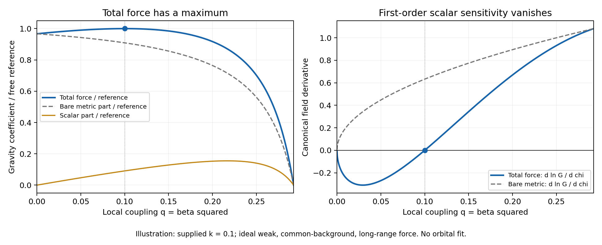

# Revised scalar theory: derivation campaign

**The fixed campaign window is closed. Research is stopped, the cooperative lock is released and the heartbeat is paused. The scientific reconstruction remains incomplete.**

Campaign window: October 13, 2026 at 14:13:22 America/New_York to October 14, 2026
at 14:13:22 America/New_York (18:13:22 UTC). New discovery stopped before the scheduled 17:58:22 UTC cutoff.
Scientific author: the parent chat, /root; independent agents performed focused
checks. No detached replacement author, formal audit, science merge or main push.

## What the campaign established

The campaign derived several useful consequences and removed specific extra
assumptions **within the supplied revised scalar action**. It did not derive a
unique action, potential, realized initial state, absolute hierarchy or complete
measured environment. It did not complete a TOE or independently validate the
candidate against observations.

The most useful advances are a conditional finite-body force/stability theorem,
a complete-body scalar-charge derivation, finite-history inverse methods that
do not require prescribed wave amplitudes, and clearer distinctions between
bare gravity, measured force and observational parameter estimates. Some
attractor, bounded-history and calibration shortcuts were disproved in their
stated domains. Keeping those failed routes was essential to the result.

There is a documented interruption. The last early checkpoint was 20:38:49 UTC
on October 13; the parent calculation finished 20:42:12 and a focused check
finished 21:00:56. Recorded parent tool work resumed 02:52:49 UTC October 14.
The cause is not established. The campaign retained its original deadline.
The records do not establish continuous authorship across the full window.

## The four requested assumption targets

| Target | Derived or eliminated conditionally | Still supplied or unresolved |
| --- | --- | --- |
| Initial state and bounded history | Sufficient future trapping; scoped finite-past bounds; actual radiation saddles and alternative limiting states; finite-window inverses eliminate selected initial amplitudes from certain parameter estimates | No realized cosmological state selected. A normalized past germ can still have divergent physical curvature. Spatial curvature, radiation production, incoming waves and initial covariance remain physical inputs |
| Action and potential | A known history fixes a potential value/gradient jet but leaves transverse curvature freedom. Ideal stationary density/force functions reconstruct a scalar-tensor action along one branch up to a real vacuum-energy ambiguity | No actual observed functions acquired; no principle selects the complete action, coupling law or potential. Reconstruction inside a chosen class is not a unique TOE |
| Scales | Several response identities and a physical-duration inequality eliminate separately inserted normalization parameters. Limited classical scaling shows what source-free dynamics cannot determine | k,nu,Hv,Q0 and the vacuum/Planck hierarchy remain unselected. Calibrating a scale from a measurement would not derive it from first principles |
| Measured-gravity/environment bridge | Source coupling, finite-profile response, static field/force bounds, sufficient uniqueness, complete-body charge and force-calibration derivatives derived from the same supplied action | A real Solar/laboratory environment, material support, ambient response, source sensitivities, boundary data, full spacetime and instrument/orbital likelihood remain to be demonstrated |

New candidate constructions were allowed, but none was counted as a retired
assumption merely because it was mathematically possible. Explicit synthetic
states, conserved stress fixtures and chosen time histories remain constructions.

## Strongest checked mathematics

Throughout, the kinetic convention is -Q K_AB partial(phi^A)partial(phi^B),
not -QK/2. The canonical coupled coordinate obeys dchi=sqrt(K_uu)du,
A is the conformal factor, beta=dlnA/dchi, q=beta^2, and 0<k<1/3.
The action and universal matter coupling are premises.

**Finite held-body theorem.** Restrict to the coupled x=y=0 channel, with
nu>0, a fixed flat background and a prescribed nonnegative bounded, compactly
supported held Einstein particle density rho_star. Normalize chi(u=0)=0, take
the negative scalar branch and zero far boundary, and set c=rho_star/(2Q),
-Delta V=c, P=||V||infinity and L=1+k. If LP<1,

    ||-chi||infinity <= sqrt(k) P/(1-LP),
    -ln A <= k P(1-LP/2)/(1-LP)^2.

A radial uniform sphere then has a derived surface-force bracket; sufficiently
small reachable field intervals give uniqueness and no growing finite-energy
scalar mode with matter and metric held fixed. A canonical Hessian refinement
gives a curvature bound approaching the vacuum mass squared as P approaches
zero at fixed parameters. A failed sufficient
criterion is not proof of instability. These results replace an assigned
interior minimum or shell factor in this class; they do not prove that an
observed body realizes the class. Eighteen nonlinear sphere profiles were
checked, with original numerical failures and corrections retained.

**Complete-body charge.** Complete isolated stationary stress conservation,
including all supports and binding contributions, gives

    integral T_ij d^3x=0,
    integral(rho-sum_i T_ii)d^3x=E.

Thus leading massless weak scalar charge equals total inertial energy without
requiring pointwise negligible pressure. This readout is the formal massless
local-operator limit, or a controlled R << r << 1/mu region when mu > 0,
with matter-free or independently negligible ambient linear response.
For a spherical finite-range source,

    Q_mu=integral[f rho+r f' T_rr]d^3x,
    f=sinh(mu r)/(mu r).

The weighted stress moment survives. Under additionally supplied rho>=0 and
|T_rr|<=rho, its charge satisfies

    2 sinh(x)/x-cosh(x) <= Q_mu/E <= cosh(x), x=mu R.

Equal-energy conserved fixtures have different finite-range charge. Ambient
subtraction alone does not remove ambient linear response; this limitation
was found, repaired and preserved before publication.

**Finite observation windows.** For a complete conserved matter tensor confined
to radius R during the required finite band, with explicit energy/component
bounds, I=integral r^2rho obeys I''=2integral sum_iT_ii in c=1 units. The signed
instantaneous trace average satisfies |Qbar/E-1|<=2R/(cT). Including retardation
gives the conservative fractional bound |Fbar_local/E-1|<=18R/(cT) for the
leading amplitude from the specified local worldtube. It does not bound radiation power, force, absolute fluctuations or
arbitrary incoming waves. Earlier/outside global source histories are not
selected by finite-band source data. The exact conserved fixture has different
instantaneous and retarded coefficients 3 and 2; replacing retarded times by a
common time fails the direct integration controls.

**Force calibration and its turning point.** In the ideal weak, common-background,
long-range readout, with a=(1-k)(1+3k)/4 and Gref=1/(8piQ0),

    Gforce/Gref=1-4(q-k)^2/[(1+k)^2(1-3q)], 0<q<a.

There is a strict maximum along the coupling coordinate at q=k; arbitrary
transverse fields are not selected. At a smooth crossing chi=0,

    dotGforce/Gforce=0,
    ddotGforce/Gforce=-32k dotchi^2/(1-3k).

A first-drift bound has no uniform inverse into coupled-scalar speed near that
point. The finite-window synthetic fit retains curvature and can have a cubic
leading fitted slope. This is not compatibility with a lunar ephemeris or
permission for arbitrarily rapid backgrounds. The unknown reference scale,
actual environment and derivative errors still matter.

**Action reconstruction and remaining freedom.** Under ideal supplied stationary
functions Gbare,rho_J,q on a connected single-field branch, F=Q/A^2 gives

    omega(F)=(1/q-3)/2,
    2F V_J'(F)-4V_J(F)=rho_J(F),
    V_J=F^2[C+integral rho_J(f)/(2f^3)df].

The C F^2 freedom changes the Einstein vacuum energy. It is not an irrelevant
constant. A background history likewise fails to determine transverse Hessians.
No actual density-response functions or independently justified action selector
were provided by the observations used here.

**Finite-history inverse and measured error.** Compact-weight weak equations can
remove free initial amplitudes from parameter reconstruction when actual measured
features have the required rank. Rank failure, source calibration and model error
remain explicit. A paired force/deflection extension re-expresses the earlier
two-epoch relation as H=G(2gamma-1)=P(a-q). Two epochs calibrate, and a third obeys
an affine residual test. The epochs must describe the same modeled source and
environment. Each epoch must satisfy its physical q-domain; the reconstructed
a and positive P must pass their admissibility and separation gates. The affine
residual alone does not certify those requirements. New finite error bounds
use measured inputs and refuse an unresolved denominator. These are prospective inference tools, not completed
observed fits. The parent finite-error control has 576/0 checks and 81 synthetic correlated-noise
cases. A separate blind checker has 2772/0 exact controls over 192 full corner
profiles, plus 1155/0 domain checks; six actual altered programs fail as intended.
These counts describe mathematical controls, not experiments. The independent
check exhibits positive epoch-dependent calibration factors that mimic a
different admissible coupling and still pass the third residual. Thus common
or independently corrected calibration remains indispensable. Its scientific, source-correspondence and committed-delivery checks are complete;
the result is preserved in [PR9566](https://github.com/jonathonreilly/qubit-lattice-axiom-framework/pull/9566).

**Past-history and thermal constraints.** Positive radiation and explicit flat,
positive-energy/charge assumptions give a physical-past duration inequality that
removes a separately supplied Hv and global conformal cap. Its CMB/G reference
normalization is about 1310.846 Gyr, not a measured age prediction. Positive curvature
and source production are distinct escape routes. For a specified ideal equilibrium
photon/electron/positron bath, correlated pressure/entropy bounds strengthen a
strict Einstein-bounce obstruction. The particle content, equilibrium, entropy
and local calibration assumptions remain; no actual thermal history was inferred.

## Observations and separation of evidence roles

| Source | Actual role | What was not done |
| --- | --- | --- |
| Published CMB temperature and CODATA G | Reference normalization for a conditional inequality | No cosmological age or hierarchy fit |
| Cassini gamma summary | Exposed interval benchmark conditional on a controlled Solar long-range bridge | No raw timing likelihood, new confidence region or unconditional k exclusion |
| Laboratory inverse-square result (Lee et al. 2020) | Motivation to derive normalized finite-geometry torque response | No raw apparatus torque fit; alpha=1 exclusion was not silently applied to q<1/3 |
| MICROSCOPE final result | Motivation for complete-body charge and common versus differential response | No telemetry fit or universal common-coupling bound from a differential null |
| Lunar-ranging papers | Measurement-method context for a force-to-orbit bridge and its limits | No ephemeris fit; the published dotG estimate was not converted to a scalar-speed limit |
| DESI/other large-scale context | Exposed development context for transfer/readout limitations | No catalogue likelihood or reserved observed test |

All real observational sources were exposed during development or used as
explicit calibration/reference inputs. **There was no completed independent
observational holdout.** Reserved synthetic points test same-model mathematics;
they are not independent empirical validation. Error envelopes in the inverse
certificates are deterministic assumptions, not automatically Gaussian intervals.

## Rejected routes and surviving failures

- The original radiation point is not a full attractor; a transverse direction
  grows. An alternative limiting branch does not select a complete history.
- Bounded normalized variables do not imply a bounded physical past. The checked
  past-convergent branch can reach divergent curvature in finite proper time.
- A unique algebraic density root is not a stability or environment-selection
  proof. Fixed-particle data can have two local minima separated by a saddle.
- Density on the negative-u branch cannot lower the coupling norm below k;
  finite range and nonlinear body response are separate mechanisms.
- A fixed material response p=3 cannot replace fluid dynamics. Conservation
  gives frequency-dependent response plus a homogeneous mode; Jeans limits persist.
- One-epoch covariance feasibility or cancellation of a common amplitude does
  not select the relative initial-mode covariance.
- Bare gravity and total force-calibrated gravity do not have equal scalar
  derivatives. A single drift summary does not supply paired varying readouts.
- Finite-range scalar charge is not fixed by mass alone. A signed source-average
  bound is not a bound on absolute fluctuations or radiation power.

Original failed calculations remain recoverable: serialization errors, finite-body
flux/mesh failures, exact conditioning repairs, proof decay gaps, source-scope
corrections and damaged implementations. Publication also exposed a prior-commit/current-commit mismatch in a mechanical
review record; correcting its original-constituent field changed no science.
Both failed records remain. A later double-root inverse needed
higher arithmetic precision at unchanged acceptance. Publication metadata also
required a line-start type declaration; that mechanical failure and correction
are separate from scientific results. None was deleted or counted as a clean
initial execution.

A historical evidence gap remains: twelve original Radau mixture profiles were
not recovered. Independent replay and summaries are distinct evidence, not
replacements mislabeled as original files. Temporary cache inputs are identified
only where exact hashes/recoveries exist; absent bytes and historical filesystem
tokens are not inferred from present files. Assertion and file counts are not
numbers of physical experiments.

## How to read the evidence

The earlier revised action was an inherited candidate, not a result selected by
this campaign. The calculations here test its consequences under the hypotheses
stated in each note. A focused independent derivation checks a particular claim;
a source-correspondence or delivery receipt checks that the reviewed bytes and
results reached the artifact. A mechanical UNIT/cache pass is an identity and
metadata gate. None of these is an experimental replication, a formal audit
verdict or a combined acceptance of every claim in the PR stack.

The report's central claim scopes were checked separately, including the
negative-branch held-body restrictions, finite-window fractional bounds,
near-zone/ambient-response requirements and the paired inverse's domain gates.
The recorded interruption and twelve missing original profiles remain gaps.

## Force-calibration illustration

The figure shows the existing ideal common-background, weak, long-range formula
and its canonical derivative for supplied k=0.1. It is an illustration of the
checked identity, not an orbit fit, chosen cosmology or additional validation.
The [vector PDF](CALIBRATED_GRAVITY_TURNING_v1.pdf) preserves the same figure.

## Artifacts and unfinished work

The [scientific milestone index](PR_INDEX.md) records 23 original deliveries,
with current GitHub status checked at 2026-10-14T18:11:30.741533+00:00: 4 closed, 19 open.
Every head matches its preserved delivery commit. Some early PRs were closed
or retargeted externally during final packaging. The current diff can therefore
contain multiple original units; the index preserves each original base and
five-path delta separately. This author did not merge, close, reopen or retarget
those PRs. The initial status-check failure and subsequent read-only reconciliation
are retained in the runtime records.

Each original milestone includes a conditional claim note, executable checker,
complete bound cache and recoverable evidence archive. Focused mathematical,
source-correspondence and delivery checks are distinct. Current GitHub metadata
is not a combined scientific acceptance of a retargeted stack.

Selected kinetic-radiation, observational-transfer, clock and rolling-inverse
extensions remain in the campaign pack without a separate canonical milestone.
The [extension inventory](EXTENSION_INDEX_v1.json) records them, including
exact source and focused-review hashes. Earlier PRs may cite portions; the index
does not promote every draft or replay to a current claim.

The separate [local preservation record](LOCAL_PRESERVATION_v1.json) identifies
primary_research_v1.tar.gz. This archive retains
7,321 primary-source payloads and is 111,750,404 bytes. Its SHA256 is
103e3004e613829dec2c5095dd2eba99f895f3896147e2b206e79185995919b5.
Every payload hash, size and corresponding original byte was checked. The
archive is local only because it exceeded the publication size gate; that
failed gate and unchanged archive were preserved. This archive excludes the
paired-error block, which has a separate milestone archive, and is not a
replacement for the individual milestone delivery records.

The next scientific bottleneck is a complete forward calculation for one actual
measurement regime, using measured source/material/environment data and an
explicit calibration/test split. It must derive or bound the environmental and
instrument terms before published statistical errors can become candidate tests.
Separately, action/potential/scale selection needs a justified mechanism that
makes a distinct prediction. Assigning a vacuum, density minimum, ensemble,
thermal history or regulator scale would not solve that task.

The fixed deadline was 2026-10-14T18:13:22Z. The owned-process inspection at
2026-10-14T18:13:33.568816+00:00 found no remaining owned research job,
and released the matching cooperative lock. The existing heartbeat is paused.
Both preceding campaigns remain stopped. Publication of this preservation
record is administrative work after the discovery cutoff, not an extension of
the research window. See [completion metadata](DEADLINE_COMPLETION_v1.json).
